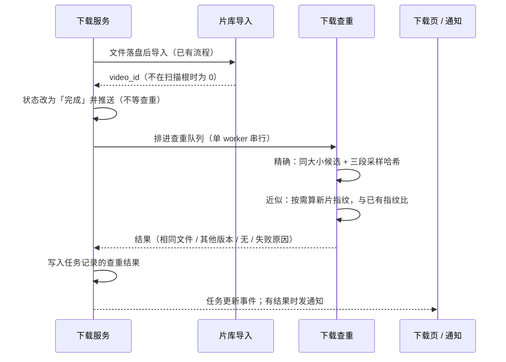

# 缩略图墙与下载完自动查重 · 概要设计

状态：下载查重 accepted（用户 2026-10-12 未提修改，按设计执行）；缩略图墙为用户修订后的界面选择；尚未实现。
来源：用户 2026-10-12 会话裁决——色彩墙「图片库和片库都做」「色块筛选 + 色彩墙视图」；下载完自动查重（清单 E）并入本批；版本对比播放器（清单 F）同批实现、本设计只引用它。
详细设计：[需求设计文档.md](需求设计文档.md)
修订：2026-10-12 初稿；同日用户把色彩墙改为「不要颜色，只要紧凑的缩略图墙」，色彩相关决定撤回。

## 背景与范围

- **缩略图墙**：片库与图片库各加一种更密的缩略图平铺，便于快速扫一眼大量内容。
- **下载完自动查重**：浏览器插件下载的片子进片库后，不会和已有内容比较，同一个文件可能下第二遍、或者已经有更清楚的版本却不知道。本次在下载完成并入库后自动比一次，结果挂在下载页那一行上，并给出处理入口。

非目标：查重不在下载开始前做（那时只有 URL 和标题，无从比较），也不改变下载本身的成败。

## 缩略图墙（取代原「色彩墙」）

**D-CW-01 · Behavior Contract · Accepted（用户 2026-10-12，修订）**：原「色彩墙」方案（12 色系取色、色块筛选、按颜色排列）撤回，不做任何颜色相关功能、不新增表与后台任务。改为片库与图片库各增加一种更紧凑的「缩略图墙」排列：只显示缩略图、密铺，排序与筛选沿用页面现有的。这是现有布局内的界面选择，实现细节不在本设计展开。

原 D-CW-02 至 D-CW-09（色系模型、侧表、取色方法、取色任务、筛选阈值、色彩墙排序、保存视图颜色字段、色系口径）随之撤回，不再实现。

## 下载完自动查重

图：下载完成后的查重时序（proposed）。查重在「完成」之后异步进行，失败不改变下载结果。

**D-DD-01 · Behavior Contract · Proposed**：下载进入「完成」后才查重，异步、单 worker 串行；查重中、失败都不改变下载状态。已入库的做精确与近似两种比对；没入库的（下载目录不在扫描根里，没有片库记录）只做精确比对。

**D-DD-02 · Behavior Contract · Proposed**：判据沿用清理中心，不另立标准。精确重复：文件大小相同且三段采样哈希一致（与清理中心精确重复同一函数）。其他版本：新片按需算一次视频指纹，与片库里已有指纹且时长可比的片做同一阈值的比对；用户以前判过「不是同一部」的对不再提示。只和已经算过指纹的片比，覆盖不全时在结果里说明「片库有 N 部还没算指纹，未参与比对」。

**D-DD-03 · Data Contract · Proposed**：查重结果写进下载任务历史表（新增一个可空的结果列），应用重启后历史里仍能看到；只存比对结论与对方视频 ID，标题、分辨率、大小在读取时按 ID 现查，对方已删除就不再显示。

**D-DD-04 · Behavior Contract · Proposed**：呈现与处理。下载页那一行显示提示块：「片库里已有完全相同的文件《X》」或「片库里有同一部的其他版本《X》（1080p，2.1 GB，比这次的更清楚 / 更小）」。动作：移到废纸篓（删这次下载的文件，走片库同一个可撤销的删除流程）、对比播放（清单 F 的版本对比播放器）、建立版本组（既有 API）、不是同一部（写入既有的近似重复忽略记录，以后不再提示）。窗口在后台时发桌面通知，在前台时应用内提示。

**D-DD-05 · Operational Contract · Proposed**：依赖方向是「下载服务 → 查重接口」，查重放在 `services` 包里复用清理与视频指纹的包内函数，由 App 注入，下载服务不直接依赖清理服务。新片指纹在查重时顺带写入（与补全任务写同一张表、同一份数据），不占重媒体槽。

## 变更与影响

- 新列 1 个（`browser_download_tasks.duplicate_result`），新增无迁移，回滚只需停用功能。
- 下载服务新增完成后的回调；下载页新增查重提示与四个动作。
- 缩略图墙只改前端布局，不改接口与存储。

## 风险与待决

- 查重只比已有视频指纹的片：如果片库指纹覆盖很低，近似比对会漏，界面上会说明，不会说成「没有重复」。
- 下载查重按设计执行；用户若后续提出修改，按修订处理。
