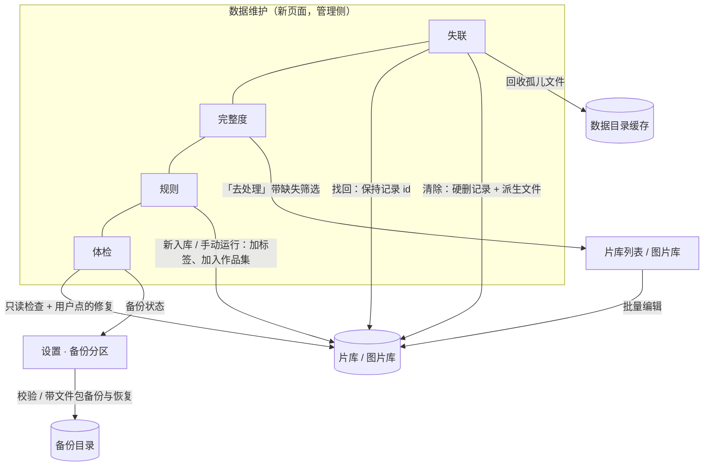
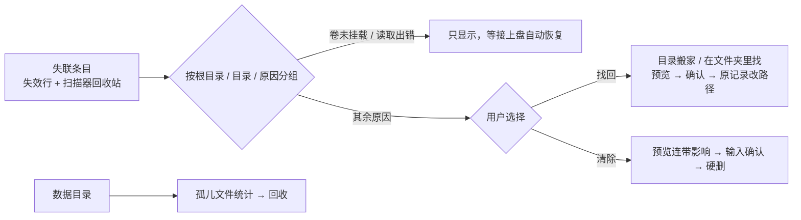
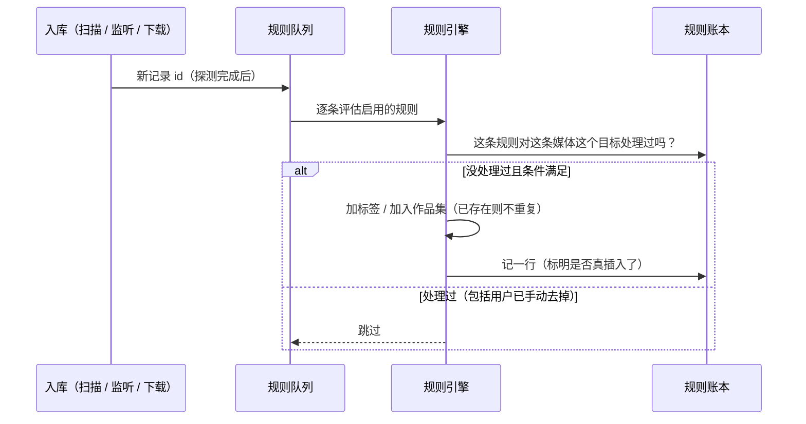

# 数据维护四项 · 概要设计

状态：全部决定 Accepted——四项产品裁决（D-LD-01、D-MC-01、D-RA-01、D-DH-01）用户 2026-10-12 选定，其余由用户同日「都需要做呀」一并接受；实施中（分支 feat/data-care）。
来源：用户 2026-10-12 会话——「倾向于数据处理……深度探索」后选定 1 失联数据治理、2 元数据完整度面板 + 批量编辑、4 本地规则自动化、5 数据健康检查与备份校验；「主力库在另一台机器」；同日四项裁决见各节 Accepted 决定。
详细设计：[需求设计文档.md](需求设计文档.md)
修订：2026-10-12 初稿；同日用户接受全部决定，进入实施。

## 背景与范围

2026-10-12 盘点代码得到的现状：

- **失联数据散在三处、清不干净。** 文件找不到的视频有两种存法：一种是仍在片库里、标了「失效」（`is_stale` + 原因），在片库的「路径失效」视图里；另一种是全量扫描确认文件消失后被软删进回收站（`deleted_by=scanner`）。图片又是另一套（只有 `is_stale`，扫描隐藏的在回收站「扫描隐藏」页）。找回只有逐条「重新定位」和按「文件名 + 大小」唯一匹配的自动纠偏；换了盘符或整个目录搬家时只能一条条点。永久删除在卷离线时会被拒绝，删掉的记录还会留下缩略图、海报副本、字幕备份、人脸截图和十几张没有外键的表里的行。
- **元数据缺什么看不出来。** 没有任何地方告诉你「多少片没有海报、没有简介、没有人物」。视频没有「年份」字段（NFO 里的年份从没读进来）。批量操作只有加/去标签和移动，没有批量改人物、作品集、评分，也没有撤销。
- **没有规则。** 只有两个写死的自动标签（短视频、低分辨率）。「下载目录里的片子都打上『待整理』」这种事只能手动做。
- **备份只管数据库、几乎不校验。** 已有定时备份（SQLite `VACUUM INTO`、Postgres `pg_dump`，保留 7 份）与恢复，但新备份从不检验能否打开，没有清单，人物头像、作品集封面、海报副本、壁纸、字幕备份都不在备份里。数据库内部的一致性（悬挂引用、该唯一却重复的行、派生计数）没有任何体检。

本次目标：在管理侧新增一个「数据维护」页，承载这四项；备份校验落在设置页现有的「备份」分区。

非目标：

- 本机片库不是主力库（主力库在另一台机器），所有设计按通用场景做，不针对本机数据做任何清理。
- 不改手机端网页；Jellyfin 只多输出年份。
- 规则不做移动、改名、删除；批量编辑不做标题/简介这类逐条不同的文本。
- 观看/管理分区重做（[2026-10-12-viewer-manager-split](../2026-10-12-viewer-manager-split/概要设计.md)）尚待确认；本设计的「数据维护」页在它落地前挂在顶栏「工具」组，落地后归入管理侧导航。

## 总体结构

图：四项功能的落点与它们改动的数据（accepted）。箭头表示用户动作或写入方向。

**D-DC-01 · Behavior Contract · Accepted（用户 2026-10-12「都需要做呀」）**：新增页面「数据维护」（页面键 `data-care`），四个页签：失联 · 完整度 · 规则 · 体检。分区重做落地前放在顶栏「工具」组「洞察」之后；落地后归入管理侧导航。命令面板为每个页签各给一条直达命令。备份的设置、列表、校验、恢复仍在设置页「备份」分区，不在新页面里重复一份；体检页的「备份」检查项链接过去。

**D-DC-02 · Operational Contract · Accepted（用户 2026-10-12「都需要做呀」）**：建议实施顺序 体检与备份 → 失联 → 完整度与批量编辑 → 规则。理由：失联清除不可撤销，先让备份覆盖整理过的文件并且可校验，清除前的「先备份」才有意义。四项之间没有代码依赖，顺序可调。

## 1 失联数据治理

图：失联页的三条路径（accepted）。

**D-LD-01 · Behavior Contract · Accepted（用户 2026-10-12）**：确认找不回来的条目「彻底清除」：记录、标签、人物与作品集关联、缩略图等派生文件一起删除；播放记录随之消失（回顾、洞察里不再计入）；观看笔记（片段书签、观影日记）照现有设计保留。确认框列出会连带删掉多少条播放记录。清除不进废纸篓（文件已经不在）。卷没挂载的条目一律不进清除。

**D-LD-02 · Behavior Contract · Accepted（用户 2026-10-12「都需要做呀」）**：失联页把视频的两种存法（失效行、扫描器软删进回收站的行）和图片的两种存法合并展示，按「扫描根目录 → 目录」分组，每组标原因与是否可清除。「卷未挂载」「读取出错」两类只展示、不给清除也不给批量找回（接上盘或下次扫描自然恢复）；其余原因（文件不见、目录已移除、不在任何扫描目录内、历史未知原因）可找回、可清除。现有片库「路径失效」视图与回收站「扫描隐藏」页保持不变。

**D-LD-03 · Behavior Contract · Accepted（用户 2026-10-12「都需要做呀」）**：「找回」保持原记录 id（Jellyfin 条目、播放历史、标签都跟着走），两种方式都先预览再执行：
- **目录搬家**：选一个失联分组的旧目录，再选新位置；每条按「相对路径相同 + 大小相同」配对。用于换盘符、整个目录挪走。
- **在文件夹里找**：选一个文件夹递归找；「文件名 + 大小」唯一命中的默认勾选；只有「大小 + 扩展名」唯一命中的列为「可能」、默认不勾；多个候选的不配对。

新位置不在任何扫描目录内的候选不能执行（否则下一次全量扫描又会把它标成失联），预览里提示「先把这个文件夹加为扫描目录」。

**D-LD-04 · Behavior Contract · Accepted（用户 2026-10-12「都需要做呀」）**：清除在执行时逐条复核：仍处于失联状态、路径所在的卷已挂载、文件确实不存在、没有进行中的超分任务，任一不满足就跳过并说明原因；不因一条失败中断整批。清除会一并处理现在硬删漏掉的东西：没有外键的引用行、版本组成员（组剩不到两个成员时解散）、观影日记对播放记录的引用置空、派生文件（缩略图、拖动预览帧、海报副本、字幕备份、人脸截图、播放代理）。

**D-LD-05 · Behavior Contract · Accepted（用户 2026-10-12「都需要做呀」）**：「孤儿文件」按数据目录里以记录 id 命名的位置统计：所属记录已经彻底不存在（软删进回收站的不算孤儿）的缓存与副本文件；按位置显示个数与大小，一键回收。播放代理沿用现有的孤儿统计与清理，不重复实现。媒体目录里的字幕文件（视频旁的 `.srt`）属于用户，不在范围内。

## 2 元数据完整度与批量编辑

**D-MC-01 · Data Contract · Accepted（用户 2026-10-12）**：视频新增「年份」字段：读 NFO 的年份，详情可编辑，批量可设置，完整度面板统计，Jellyfin 输出年份。「类型」继续用标签表达，不新增字段。

**D-MC-02 · Behavior Contract · Accepted（用户 2026-10-12「都需要做呀」）**：完整度页签按默认可见范围（扫描根 + 排除列表 + 非失效）统计：
- 视频：显示标题、年份、简介、海报、背景图、人物、标签（不算自动标签）、字幕、技术信息、缩略图，以及 NFO 状态（有更新、读取出错）。
- 图片：拍摄时间、地理位置、标签、人物。

每项显示缺失数和占比，可展开「缺得最多的目录」；「去处理」跳到片库或图片库，并带上这一项的缺失筛选。个人评分、作品集不算完整度（不是每部片都该有）。

**D-MC-03 · Behavior Contract · Accepted（用户 2026-10-12「都需要做呀」）**：片库与图片库的筛选新增「缺失某项」条件，可与搜索、标签、智能视图等其他条件叠加，可随保存视图保存。完整度页的「去处理」就是设好这个条件的列表，补完一条后它自然离开列表（键集分页不会因此漏行）。

**D-MC-04 · Behavior Contract · Accepted（用户 2026-10-12「都需要做呀」）**：批量操作栏新增「批量编辑…」，作用于所选条目，或「当前筛选的全部结果」（执行时由后端按筛选重新取一遍）。可同时做多项，每项是一个明确操作：
- 视频：年份设为/清空、评分设为/清空、标签加/去、人物加/去、作品集加入/移出。
- 图片：标签加/去、人物加/去、评分设为/清空。

执行前预览每项「实际会改变几条」。批量去掉人物关联时不删除人物本身，这一点不同于详情编辑：详情里去掉某人最后一条关联会连人物一起删。

**D-MC-05 · Behavior Contract · Accepted（用户 2026-10-12「都需要做呀」）**：每次批量编辑只记下真正改动了的条目和改动前的值，最近 20 次可以撤销；撤销时某条已被之后的操作改过，就跳过这一条并计数说明。没有逐字段锁：批量清空的年份等字段，如果片子旁有 NFO，会被 NFO 补全任务按「空就补」重新填上。这是已知限制，界面上提示。

## 3 本地规则自动化

图：新入库条目的规则评估（accepted）。手动「对现有内容运行」走同一个引擎，只是条目来源换成按筛选分批取。

**D-RA-01 · Behavior Contract · Accepted（用户 2026-10-12）**：规则第一版只做「加标签」「加入作品集」，只加不撤：规则加上的东西被用户手动去掉后要记住、不再加回；新入库条目自动跑，也可以对现有内容先预览再执行；不做移动、改名、删除。

**D-RA-02 · Behavior Contract · Accepted（用户 2026-10-12「都需要做呀」）**：一条规则 = 媒体类型（视频或图片）+ 一组同时满足的条件 + 一到多个动作。条件只看文件和技术属性：所在目录、文件名包含/通配/正则、扩展名、大小、时长、画面高度、视频编码；图片另有「有无地理位置」。条件不引用标签和作品集，规则之间因此不会连锁触发。技术属性还没探测出来时，这一项视为不满足；探测补完后再评估一次。

**D-RA-03 · Data Contract · Accepted（用户 2026-10-12「都需要做呀」）**：规则账本记录「哪条规则对哪条媒体的哪个目标处理过」，每个组合至多处理一次。关系本来就存在时也记一行（标为未插入），于是用户以后去掉这个标签，规则也不会加回来。删除规则只删它的账本，不撤它加过的标签。这沿用人脸链路「只记自己真正写过的关系」的做法（`face_relation_writes`）。

**D-RA-04 · Behavior Contract · Accepted（用户 2026-10-12「都需要做呀」）**：规则加的标签就是普通标签：显示、筛选、「未打标签」视图都把它当标签。唯一例外是 AI 自动打标的「已有人工标签就跳过」：规则真正插入的标签不算人工标签。否则一条「下载目录打『待整理』」的规则会让所有新下载都跳过 AI 打标。

**D-RA-05 · Behavior Contract · Accepted（用户 2026-10-12「都需要做呀」）**：规则在以下时机评估：
- 新记录建好、探测完成之后（扫描、目录监听、浏览器下载、重新导入都经过同一个创建入口）；
- 技术信息补探测成功之后；
- 用户手动运行时。

不评估的情况：
- 回收站恢复、文件搬家纠偏（不是新条目）；
- 视频工作台和超分的产出（它们从源视频复制标签）。

新建或修改规则不会自动扫一遍现有内容，要用户点「对现有内容运行」。标签或作品集被删时，引用它的动作失效；规则没剩下动作就自动停用并注明原因。标签合并时，规则里的引用一并改写。

## 4 数据健康检查与备份校验

**D-DH-01 · Behavior Contract · Accepted（用户 2026-10-12）**：备份范围扩到「数据库 + 整理过的文件」：每次备份另带一个文件包（人物头像、作品集封面、海报副本、想看封面、壁纸、字幕备份），并生成清单用于校验；恢复时一起还原。不含 `.env`（里面有数据库密码）。

**D-DH-02 · Data Contract · Accepted（用户 2026-10-12「都需要做呀」）**：每份备份由三个文件组成：数据库快照（格式不变）、文件包、清单。清单写明：
- 后端、创建时间；
- 两个文件的大小与 SHA-256；
- 文件包里每个文件的路径、大小与哈希；
- 表结构指纹；
- SQLite 快照另记各表行数与完整性检查结果。

新备份在发布前就要通过检查（SQLite 只读打开 + 快速完整性检查），不通过就不发布、记一次失败。备份列表改读清单，不再每次打开设置页都把所有备份重新算一遍哈希。没有清单的旧备份照常列出，标「旧格式：仅数据库、未校验」，仍可恢复。

**D-DH-03 · Behavior Contract · Accepted（用户 2026-10-12「都需要做呀」）**：备份列表每份多一个「校验」：
- 重算两个文件的哈希并与清单比对；
- SQLite 再只读打开快照，做完整性检查，核对各表行数；
- Postgres 备份只能核对哈希和归档目录可读（不做试恢复）。

恢复前检查表结构指纹：备份里有当前版本不认识的表或列，说明它来自更新的版本，拒绝恢复。恢复时先做的安全备份也带文件包，所以被覆盖的整理文件同样可以找回。

**D-DH-04 · Behavior Contract · Accepted（用户 2026-10-12「都需要做呀」）**：体检页签手动运行，全程只读，可取消，逐项给出结论、数量、示例与说明。检查项：
- 数据库文件完整性（SQLite）；
- 外键悬挂（SQLite）与代码维护的引用悬挂（父记录已彻底不存在）；
- 该有却缺失的唯一索引及其重复组；
- 可由明细重算的派生计数是否漂移；
- 指向数据目录内文件的路径列是否指向不存在的文件；
- 备份状态。

播放次数不在计数检查内：它不能由播放记录重算，历史播放只补过一条「历史补记」。

**D-DH-05 · Behavior Contract · Accepted（用户 2026-10-12「都需要做呀」）**：修复只给「结果确定、可由现有数据推出」的项，每项由用户点击执行，执行后重跑该项：
- 删除父记录已不存在、本身没有独立意义的引用行（忽略记录、人脸关系记账、待播队列等）。观看笔记按设计本就比视频活得久，不算悬挂。
- 按明细重算派生计数。
- 清空指向不存在文件的托管路径列。

唯一索引缺失与重复只报告不修，因为去重要人来判断。孤儿文件在「失联」页签回收，体检页只给链接。

## 变更与影响

- **新增数据**：
  - 视频年份列；
  - 规则表与规则账本；
  - 批量编辑记录与明细；
  - 保存视图的「缺失」列；
  - 体检报告（只留最近几次）；
  - 备份目录里每份备份多出文件包与清单。

  新表按外键顺序追加到 `AllModels`，SQLite→Postgres 迁移随之覆盖。
- **新增后台任务键**：失联（找回/清除/回收）、批量编辑、规则运行、数据体检。每个键都要接任务中心、空闲调度标签，进入数据库恢复维护时停止，退出时等待写任务收尾。
- **改动的现有行为**：
  - 备份产物多两个文件，列表改读清单，恢复会一并还原文件包；
  - 详情编辑多一个年份字段。整体替换式的 `UpdateVideoDetails` 必须带上年份，所有调用方同步改；
  - AI 自动打标的「已有人工标签」判定排除规则插入的标签；
  - NFO 导入多读年份，NFO 导出多写年份；
  - Jellyfin 条目多一个年份。
- **受保护的旧行为**：
  - 「路径失效」视图、回收站「扫描隐藏」、现有逐条重新定位与自动纠偏不变；
  - 普通删除与废纸篓流程不变；
  - 旧格式备份仍可恢复；
  - 两个写死的自动标签与它们的覆盖表不变。

## 风险、验证与待决事项

- **清除不可撤销**：靠执行时逐条复核、卷未挂载一律跳过、确认框列出连带影响与「先备份」入口来兜底（D-LD-01/04）。
- **SQLite 单写者**：所有批量写都按 500 条一批、短事务，避免扫描、监听、AI 打标拿不到锁（D-LD-04、D-MC-04、D-RA-05、D-DH-05）。
- **文件包体积**：海报副本多时文件包可能远大于数据库，备份前检查可用空间，空间不够这次备份失败并说明原因（D-DH-01）。
- **NFO 补全会填回批量清空的字段**：已作为已知限制写进 D-MC-05，不加逐字段锁。

全部决定已由用户接受（2026-10-12）。验证策略与决定索引见[详细设计 · 验证与交接](需求设计文档.md#验证与交接)。
