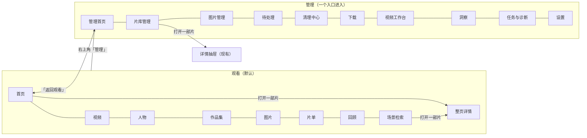

# 观看与管理分区 · 概要设计

状态：全部决定 Accepted——D-UI-01 用户裁决，其余由用户 2026-10-12「都需要做呀」一并接受；排在数据维护四项之后实施一期。
来源：用户 2026-10-12 会话——「当前界面过于看重管理」「回顾页设计很棒」「区分管理和用户看到的页面重新做一版」；同日四项裁决见 D-UI-01。原型：<https://claude.ai/artifact/XynGCqZC2ZnwLzHNjPADqP>（原型画的是顶栏双开关，已被 D-UI-01 的「管理收进一个入口」取代，以本文为准）。
详细设计：[需求设计文档.md](需求设计文档.md)
修订：2026-10-12 初稿。

## 背景与范围

现状（2026-10-12 盘点代码）：

- 没有首页，打开应用落在片库页（`VideoListPage`，3200 行）。它同时承担浏览和大部分库管理：扫描、迁移、批量标签、字幕、超分、清理、AI 审阅都从这里进。
- 任何页面「打开一部片」都会先切回片库页，再在右侧开详情抽屉。抽屉一半是编辑表单：没有只读简介，没有标签区，不显示海报和背景图。
- 视频的海报和背景图在导入 NFO 时已经存了（`videos.poster_path` / `fanart_path`），但没有图片路由，界面从没用过。
- 顶栏把「片库 / 片单 / 工具」三组导航、设置、待播队列、待处理、任务放在一排，观看与维护入口混在一起。

本次目标：把「看片」和「维护片库」分开。观看侧是默认体验，视觉沿用观看回顾页；维护片库的功能收进一个「管理」入口。

分三期（D-UI-01 已定先做一期）：

| 期 | 内容 |
|---|---|
| 一期 | 顶栏重组与「管理」入口、观看首页、整页沉浸式详情、接通海报与背景图、「打开一部片」按所在区域分流 |
| 二期 | 观看侧浏览页：片库海报墙、人物与作品集（剧集进度）、片单合一、搜索合一（片名/台词/画面/以图）、首页补「追到哪了」「想看已在库」 |
| 三期 | 管理侧整合：待处理从弹窗升级为页、视频与图片清理合并、片库管理页去掉浏览向的东西 |

非目标：不改手机端网页与 Jellyfin 接口；不做 macOS 三栏（2026-08-04 裁决仍有效）；一期不改动现有管理功能本身。

## 核心方案

### 两个区域

图：一期之后的两个区域与「打开一部片」的去向（accepted）。箭头表示用户的导航动作。

**D-UI-01 · Behavior Contract · Accepted（用户 2026-10-12）**：观看与管理分开；管理收进一个入口（不是顶栏双模式开关）；打开应用默认进观看首页；观看侧打开一部片用整页详情，管理侧保留现在的详情抽屉；先出设计、确认后做一期。

**D-UI-02 · Behavior Contract · Accepted（用户 2026-10-12「都需要做呀」）**：顶栏在两个区域里各显示一套导航，共用同一条顶栏和同一个滚动容器。
- 观看：首页 · 视频 · 人物 · 作品集 · 图片 · 片单（下拉：想看、榜单、观影记录、观看笔记）· 回顾 · 场景检索。右侧是待播队列和「管理」按钮。待处理的数量作为角标显示在「管理」按钮上。
- 管理：返回观看 · 管理首页 · 片库管理 · 图片管理 · 待处理 · 清理中心 · 下载 · 视频工作台 · 洞察 · 任务与诊断 · 设置。

不做左侧栏，原因是片库和图片库的虚拟滚动都以顶栏下方唯一的滚动容器为宿主，加侧栏会动到它。命令面板和快捷键照样能直达两侧所有页面。

**D-UI-03 · Behavior Contract · Accepted（用户 2026-10-12「都需要做呀」）**：一期的管理侧沿用现有页面和面板，只是从管理导航进入：
- 片库管理 = 现在的片库页，图片管理 = 现在的图片页；
- 待处理 = 现在的待处理弹窗；清理中心 = 现在的清理面板与图片清理审阅；
- 任务与诊断 = 现在的任务中心抽屉。

新增的只有「管理首页」：
- 四张统计卡：待处理、可回收空间、运行中的任务、离线的硬盘；
- 最近的变化：扫描、下载查重、备份。

一期观看导航里的「视频」暂时也指向现在的片库页，二期再换成观看向的海报墙。

### 观看首页

**D-UI-04 · Behavior Contract · Accepted（用户 2026-10-12「都需要做呀」）**：首页从上到下：
1. 大幅背景区：优先「继续观看」最近一部；没有就取「今晚看什么」的第一条。
2. 继续观看。
3. 今晚看什么：每条带推荐理由，可以「换一批」。
4. 最近添加：海报墙。
5. 本月常看的人物。
6. 本月回顾亮点：入口进回顾页。

一期只用现有接口，各区块独立加载、独立失败；某一块没有数据就不显示，不留空壳。「追到哪了」「想看的片片库里已有」要新的后端聚合，放二期。

### 整页详情

**D-UI-05 · Behavior Contract · Accepted（用户 2026-10-12「都需要做呀」）**：整页详情的主体是只读展示：
- 背景：优先背景图，没有时用画面帧慢速轮播，沿用回顾页的大图组件；
- 海报：没有海报时用缩略图；
- 片名、原始片名、年份、时长、分辨率、版本数、评分、标签；
- 简介（没有就不显示这一节）、演职人员、片段书签、相关推荐、版本（带「对比画质」）、所属作品集、看过的记录。

动作：播放（外部播放器，与抽屉的「播放」同一调用）、在应用内播放、加入待播、收藏、标记已看、评分、台词卡、找相似画面。

「编辑资料」进入管理侧，在详情抽屉里改。要在整页里内嵌播放，需要先把抽屉里的内嵌播放器抽成独立组件，让抽屉和整页共用。这是一期最大的改动，见[详细设计](需求设计文档.md#内嵌播放器抽取)。

**D-UI-06 · Interface Contract · Accepted（用户 2026-10-12「都需要做呀」）**：接通海报与背景图。新增本地图片路由，读 NFO 导入时存下的图片：
- 海报找不到时，服务端直接回落为视频缩略图，所以卡片总能拿到一张图，也不会发出注定 404 的请求；
- 背景图找不到时返回 404，由详情接口里已有的 `has_fanart` 让前端事先知道，改用画面帧。

**D-UI-07 · Behavior Contract · Accepted（用户 2026-10-12「都需要做呀」）**：「打开一部片」按调用方所在区域分流：
- 观看侧进整页详情：首页、回顾、观看笔记、场景检索、片单、人物与作品集、待播队列；
- 管理侧仍切到片库管理并开抽屉：片库管理、清理、待处理、下载、工作台。

整页详情有自己的返回栈：从哪来，返回就回到哪里，并恢复滚动位置。

### 视觉

**D-UI-08 · Operational Contract · Accepted（用户 2026-10-12「都需要做呀」）**：观看侧沿用回顾页的视觉。复用回顾页现有的大图、海报卡、统计数字、图标组件（它们自带样式）。回顾页里只在本页生效的统计卡、区块标题、横向条带等样式，挪到全局样式里，作为观看侧的共享样式。现在已经有三份「和回顾页统计卡同一个样子」的复制（存储体检、图片清理审阅），借这次一起收拢成一个组件。

## 变更与影响

- **前端**：
  - 新增页面：观看首页、整页详情、管理首页；
  - 顶栏改为两套导航；
  - 内嵌播放器从详情抽屉中抽出为独立组件；
  - 「打开视频」的路由分流；
  - 回顾页部分样式提升为全局。
- **后端**：新增海报与背景图路由，不改数据表，不新增 App 方法。
- **受影响的守卫测试**（按新导航同步更新，不是放宽）：
  - 导航与命令：`appCommands.test.js` 钉死了导航组名，`App.test.js` 钉死了顶栏信息架构；
  - `scripts/` 下对 App.vue 等文件的源码正则测试；
  - data-test 基线：只增不减，原有钩子都要保留。
- **受保护的旧行为**：
  - 管理侧所有现有功能、快捷键（⌘K 清理中心等）、命令面板命令 ID 不变；
  - 片库管理里打开详情仍是抽屉；
  - 手机端与 Jellyfin 不受影响。

## 风险与待决

- **内嵌播放器抽取**：抽屉 1556 行，播放、进度上报、书签区间、代理回落都在里面，是一期回归风险最大的部分。实施时先抽组件、让抽屉用新组件且行为不变，再给整页详情用。
- **默认落地页从片库页改为首页**：片库页仍常驻挂载，以前「打开即开始加载片库」的时机会变。需要确认启动扫描、命令面板、待处理跳转在片库页还没显示时都正常。
- **原型与本文不一致**：原型画的是顶栏双开关，已按 D-UI-01 改为一个入口。
- **待用户确认**：D-UI-02 至 D-UI-08。
