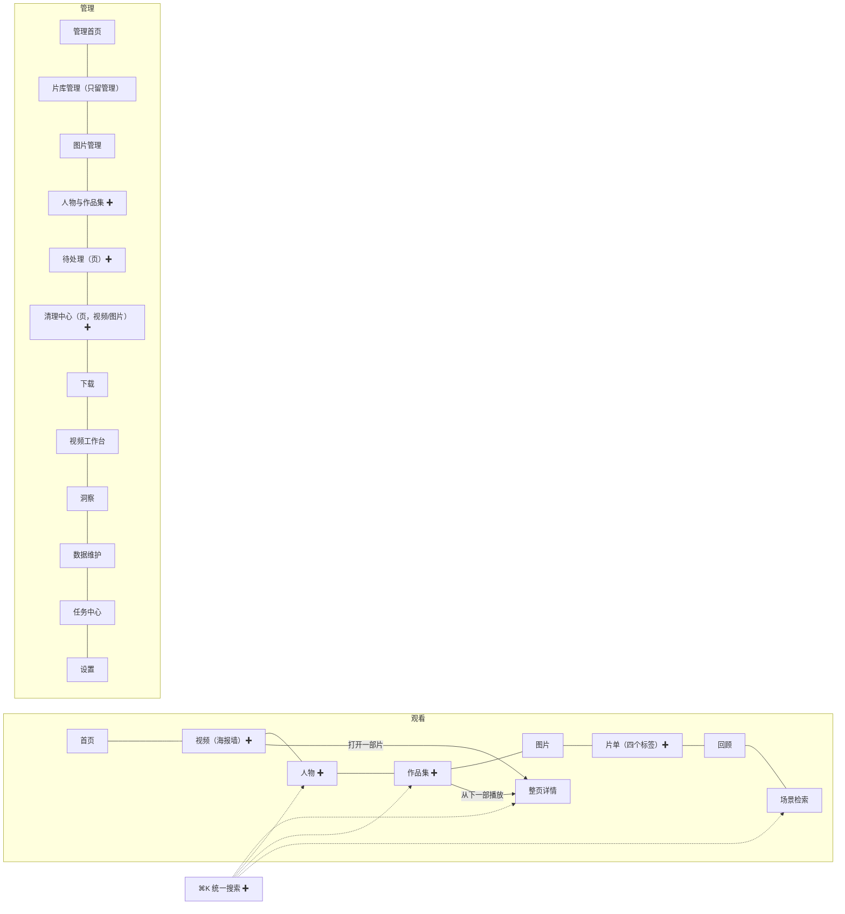

# UI 二期（观看侧）与三期（管理侧）· 概要设计

状态：Accepted——范围来自已接受的路线（[观看与管理分区](../2026-10-12-viewer-manager-split/概要设计.md) 的二期、三期，[统一设计](../2026-10-13-unified-design/概要设计.md) 方案画布的「实施路线」）；用户 2026-10-13 裁决 D-P2-02、D-P2-03；其余为主代理在已接受范围内的设计选择。二期已实施（2026-10-13，分组 P2-A..E，后端经两轮独立评审修复）；三期待实施。
来源：用户 2026-10-13「ui 二三期都需要做了」；同日两项裁决（「追到哪了」按作品集算；想看已在库：片名+年份完全一致自动认、其余确认）。
详细设计：[需求设计文档.md](需求设计文档.md)
规范：全部页面按[统一设计](../2026-10-13-unified-design/概要设计.md)（D-UD-*）的组件、刻度与交互规则实施；观看侧在影院表面（`.surface-cinema`）上。
修订：2026-10-13 初稿；同日评审修订 D-P2-03 的存储方式（关联只住一张表、按作品解除、榜单解除也记录）。

## 背景与范围

一期之后（2026-10-13 读代码核实）：

- 「视频」与「片库管理」是同一个常驻的 `VideoListPage` 实例，观看侧看到的是整套管理工具栏（扫描、迁移、批量、字幕……）。
- 人物、作品集是同一个 `EntityLibraryPage`，浏览与编辑混在一起（新建、合并、删除、人脸审阅都在观看侧）。作品集卡片看不出看到哪一部。
- 片单是四个独立页面（想看、榜单、观影记录、观看笔记），顶栏用下拉进入。
- 搜索分散在六处：片库（文件 / 字幕 / 语义）、场景检索（台词 / 画面 / 以图）、图片库、人物、作品集、命令面板（命令 + 片名前 8 条）。
- 「想看」只有豆瓣来源能和片库关联（`movie_video_links`，手动确认）；其他来源没有任何关联。
- 片库里没有剧集模型（无季 / 集字段，NFO 只认 `movie`）；有顺序的只有作品集（`collection_videos.position`）。
- 待处理是一个小弹窗，每一项都跳到别处处理；清理在视频侧是弹窗、在图片侧是整页，两套流程。
- 片库页常驻的后台状态条还没收进任务中心（任务中心缺跳过数、已取消、复用 / 移出范围、「无需补全」、导出 NFO 的取消）。

| 期 | 内容 |
|---|---|
| 二期 · 观看侧 | 视频海报墙独立成页；「追到哪了」（作品集进度）；想看已在库；片单合一；⌘K 统一搜索；人物、作品集观看页；首页补两栏 |
| 三期 · 管理侧 | 待处理成页；清理中心合并视频与图片；片库管理只留管理；人物与作品集管理（含人脸审阅）；后台状态条收进任务中心；「最近操作」接入其余可撤销操作 |

非目标：不改手机端网页与 Jellyfin 接口；不加剧集（季 / 集）模型与 tvshow NFO；不改命令 ID；不做左侧栏。

顺序：先二期、后三期（D-UD-01「不并行」），每期内部按文件归属分组并行。三期依赖二期把浏览向功能搬到观看侧之后，才能从片库管理里删掉。

## 区域与页面

图：二三期之后的页面（✚ 为新页或改成页）。⌘K 在两个区域都可用，结果按所在区域分流（沿用 D-UI-07）。

## 二期 · 观看侧

**D-P2-01 · Behavior Contract · Accepted（路线）**：「视频」改为独立的海报墙页 `VideoBrowsePage`，不再与片库管理共用实例。
- 只做浏览：搜索片名、按标签 / 人物 / 观看状态（全部 · 没看过 · 在看 · 看过 · 收藏）筛选，排序「最近添加 · 年份 · 片名 · 评分 · 均衡」。版本组合并成一张卡。
- 「随机播放」与「今晚看什么」放在这一页（随后三期从片库管理里拿掉）。
- 顶部一条「追到哪了」（D-P2-02），没有数据不显示。
- 点卡片进整页详情；没有批量操作、没有行菜单、没有管理入口。
- 片库管理（`library-manage`）仍是 `VideoListPage`，两者筛选状态各自独立。

**D-P2-02 · Data Contract · Accepted（用户 2026-10-13「按作品集算」）**：「追到哪了」以作品集为单位，不加剧集模型。
- **一部**：作品集成员按 `position` 排序；同一版本组的成员合并算一部，任一成员看过即算看过。
- **进度**：已看部数 / 总部数；在看 = 有续播位置、还没看完。
- **下一部**：最近一次看过或在看的那一部，若还没看完就是它（续播）；否则是它之后第一部没看完的；后面都看完了，取最前面一部没看完的；全部看完则没有下一部（作品集算看完）。
- **出现在「追到哪了」**：至少两部、至少看过或在看一部、还没全部看完；按最近一次观看时间倒序。
- 后端新增一个汇总接口（[详细设计](需求设计文档.md#collection-progress)），首页、视频页、作品集页共用；手机端与 Jellyfin 不变。

**D-P2-03 · Data Contract · Accepted（用户 2026-10-13「片名+年份完全一致自动认，其余确认」）**：想看条目与片库视频的关联。
- **自动**：条目的片名与视频的显示片名、原始片名或文件名（规范化后）完全一致，且两边年份都有、且相同，且只对上一部作品（版本组算一部）时，直接关联，标「自动匹配」。
- **建议**：其余可能的匹配在片单页列为「片库中可能已有」，点「确认」才关联。
- **解除**：任何关联都可解除（片单页或榜单页）；解除过的这部作品（版本组算一部）不再自动关联。
- **适用范围**：所有来源（豆瓣、TMDB、Bangumi……以及手动添加的条目）。想看的关联只存一张表（按条目记，与来源无关，来源切换不丢）；自动关联只写这张表，不进榜单的 `movie_video_links`，所以不触发榜单的已看同步。豆瓣条目读取时并上榜单页建的关联，片单页手动确认 / 解除豆瓣条目时同步到榜单（[详细设计](需求设计文档.md#watchlist-links)）。
- **何时匹配**：新增或修改想看条目、在线补全完成、扫描入库新视频、视频片名或年份变了、回收站恢复之后各跑一次（只匹配还没关联的条目，开销与想看条数成正比）。
- **用途**：首页「想看的片片库里已有」（只列已关联、还没看过的），片单「想看」标签里显示「已在库 · 播放」。

**D-P2-04 · Behavior Contract · Accepted（路线）**：片单合一。一个页面 `lists`，四个标签：想看 · 榜单 · 观影记录 · 观看笔记，内容就是现有四页（换到 `AppTabs` 下）。顶栏「片单」不再是下拉。原来的页面 key 与命令照旧可用：打开 `watchlist` 等于打开 `lists` 的「想看」标签，其余同理。

**D-P2-05 · Behavior Contract · Accepted（路线）**：⌘K 统一搜索。命令面板输入框同时搜：
- 命令（现有）、视频（片名）、人物、作品集、台词（场景检索的对白）、画面（场景检索的画面）；
- 以图：在面板里粘贴或拖入一张图片，按图找画面。

结果按组显示，每组最多 5 条，组标题旁「查看全部」进对应页面（视频 → 视频页搜索、台词 / 画面 / 以图 → 场景检索、人物 / 作品集 → 对应页）。各组独立加载、独立失败（一组报错不影响其他组），旧的输入的结果晚到会被丢弃。场景索引没建时台词 / 画面组只显示一行说明。

**D-P2-06 · Behavior Contract · Accepted（路线）**：人物、作品集观看页（`people` / `collections` 改用新的观看组件，编辑全部移到管理侧，见 D-P3-04）。
- **人物**：头像墙（按出现次数、名称排序，可搜）；人物页是大图头部 + 作品海报墙 + 相关图片条带。
- **作品集**：封面墙，每张卡带进度条（D-P2-02）；作品集页按顺序列出各部（看过 / 在看 / 没看标记），「从下一部播放」「全部加入待播」。
- 头部有「在管理中编辑」入口，跳到管理侧对应对象。

**D-P2-07 · Behavior Contract · Accepted（一期 D-UI-04 预留）**：首页补两栏，各自独立加载、没有数据不显示：
- 「追到哪了」放在「继续观看」之后：每张卡是作品集封面 + 「第 N / M 部」+ 下一部名称，点击直接播下一部（整页详情）。
- 「想看的片片库里已有」放在「最近添加」之后：海报 + 「播放」。

## 三期 · 管理侧

**D-P3-01 · Behavior Contract · Accepted（路线）**：待处理从弹窗变成管理侧页面 `pending-work`（命令 `action:pending-work` 改为打开这一页）。每类一个区块，独立加载、独立失败：
- **页内直接处理**：人脸待命名与待确认追加（嵌入现有人脸审阅面板）、建议作品集（逐条采纳 / 忽略）、本地资料有更新（逐条或全部应用）。
- **进入专门工具**：AI 视频标签、同源、AI 图片标签（打开现有审阅对话框）、清理候选（进清理中心）。
- 区块顶部写数量与上次更新时间；处理完的区块自动收起成一行「已处理完」。顶栏「管理」角标数量不变。

**D-P3-02 · Behavior Contract · Accepted（路线）**：清理中心成为管理侧页面 `cleanup`（⌘⇧K 与命令 `library.openCleanup` 照旧打开它），两个标签：视频 · 图片。
- 视频清理从片库页里的弹窗搬到这一页，结构改成与图片清理一致：顶部分类统计卡（精确重复 · 疑似重复 · 同源片段 · 极短 / 低清 · 已忽略）、按目录分组、每组「设为保留」「不是重复」、底部选择操作条「移到废纸篓」。
- 两侧共用同一个分组 / 选择 / 删除宿主（现有 `utils/cleanupSelection.js` 与 `TrashUndoBanner`），后端接口不变。
- 视频侧的合并元数据（「先合并再删」）与图片侧一致。

**D-P3-03 · Behavior Contract · Accepted（路线）**：片库管理只留管理。
- **拿掉**：随机播放与「今晚看什么」、缩略图墙布局、观看向的智能视图（继续观看、最近播放、收藏……），这些在二期已经有观看侧的去处。
- **保留**：搜索（文件 / 字幕 / 语义）、筛选与管理向智能视图（缺少…、本地资料有更新、未打标签……）、列表与网格布局、批量操作条、行菜单、「管理」菜单（扫描、整理、补全、维护）。
- 已保存的视图里用到被拿掉的排序或视图的，打开时退回默认并提示一次。

**D-P3-04 · Behavior Contract · Accepted（路线）**：人物与作品集管理页 `entities-manage`，三个标签：人物 · 作品集 · 人脸审阅。
- 现在 `EntityLibraryPage` 里的编辑功能全部搬来：新建、改名、合并、删除、批量关联（详情抽屉的实体编辑）、从片库移除媒体、解绑图片、作品集排序。
- 人脸审阅（待命名、待确认追加、已忽略）作为一个标签，命令 `people.openFaceReview` 打开它。
- 观看侧的人物 / 作品集页不再有任何编辑入口，只有「在管理中编辑」。

**D-P3-05 · Interface Contract · Accepted（统一设计 D-UD-11 实施修订）**：后台状态条收进任务中心。
- 任务中心的条目补上：跳过数、已完成 / 已取消、复用 / 移出范围（近重复指纹）、「无需处理（已是最新）」、准备中。
- 导出 NFO 与补全本地资料拆成两个任务条目，导出可以在任务中心取消。
- 补齐后片库页拿掉后台任务状态条；页内只留本页自己的增量扫描进度与语义搜索提示（D-UD-11）。

**D-P3-06 · Behavior Contract · Accepted（统一设计 D-UD-09）**：「最近操作」接入其余已有撤销接口的操作：标签转人物、清理「不是重复 / 忽略」、人脸组忽略、作品集采纳建议。没有撤销接口的操作不接（不新增后端撤销）。

## 风险与取舍

- **海报墙规模**：几千部的海报墙不做虚拟滚动，靠分页加载（每批 60）、图片懒加载与 `content-visibility`。若真机上滚动卡顿，再按片库页的做法加窗口化。
- **片名排序**：中文按拼音才有用。用 Go 的 `golang.org/x/text/collate`（中文规则）算排序键存进视频表，两种数据库顺序一致、游标可用；代价是所有改片名的写入都要同步这个键（[详细设计](需求设计文档.md#title-sort)）。
- **自动关联误配**：同名同年的不同作品会被错连；有「自动匹配」标记、可解除、解除后不再自动连。
- **三期删功能**：片库管理拿掉随机 / 今晚看什么 / 缩略图墙，前提是二期观看侧已经有；相关命令 ID 保留。

## 待定

无。D-P2-02、D-P2-03 用户已裁决；其余按已接受的路线。
