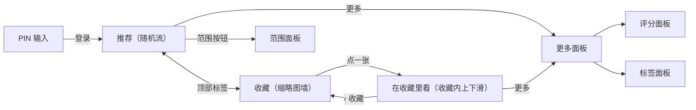

# 手机网页重做 · 概要设计

状态：Accepted——用户 2026-10-14 看过设计稿并裁定 D-MW-03（删除不确认、不撤销）与 D-MW-01（顶部标签）；其余按设计稿。
来源：用户 2026-10-14「手机网页连交互一起重做」（推翻[统一设计](../2026-10-13-unified-design/概要设计.md)「受保护的旧行为」里的「手机端网页」一项）；设计稿 https://claude.ai/artifact/TAhRC8m7kGhVv24yrdmRbR （11 屏）。
详细设计：[需求设计文档.md](需求设计文档.md)
现状说明：[docs/short-feed-lan.md](../../../short-feed-lan.md)（访问边界、入选规则、媒体字节、互动回写——这些都不变）。

## 背景与范围

手机网页（`frontend/short.html` → `src/short-feed/`）是局域网里刷本机短视频与图片的全屏流。2026-10-14 读代码核实的现状：

- 顶栏挤：「短视频」标题（流里其实混着图片）、计数、范围、全屏、收藏夹、静音六样东西。
- 右侧一列六个按钮（收藏、点赞、评分、标签、已看、删除），盖住画面，删除就在手边。
- 收藏夹是纯文字列表，点一条是把它插进随机流里。
- 评分是 21 个数字格子；删除先弹确认、删完又给撤销。
- 样式自成一套（`short-feed.css` 里约 90 处字面色），不在统一设计的刻度与守卫之内。

范围：只改手机网页的页面结构、交互与样式。**不变**：Jellyfin 接口；访问边界、PIN 与限次；入选规则、媒体字节与代理；互动回写（收藏 / 点赞 / 评分 / 已看 / 标签都写桌面同一份数据）；上下划、长按、双击、控件自动收起、唤醒锁、全屏能力判断、取下一条失败的重试。

## 页面与流转

## 决定

**D-MW-01 · Behavior Contract · Accepted（用户 2026-10-14「顶部就好」）**：顶部两个标签「推荐 · 收藏」，不用底部标签栏，画面保持全屏。去掉「短视频」标题、计数与位置圆点。推荐页顶栏右侧只有范围按钮（显示当前范围）与静音；全屏移进「更多」。

**D-MW-02 · Behavior Contract · Accepted（设计稿）**：右侧只留三个：收藏、点赞、更多。「更多」是底部面板：个人评分（显示当前分）、标签（显示个数）、已看过（开关，只对视频）、全屏播放（浏览器支持时）、移到废纸篓（红色，放最后）、取消。长按同时点赞 + 收藏照旧。片名、类型 · 时长 · 评分 · 已看、标签行在左下；标签行末尾「＋ 标签」打开标签面板。

**D-MW-03 · Behavior Contract · Accepted（用户 2026-10-14「不弹确认，也不用撤销」）**：手机端删除不弹确认、不给撤销。点「移到废纸篓」直接移走，流前进到下一条，提示「已移到废纸篓，可在电脑端回收站恢复」。失败照旧按三种原因提示（不支持废纸篓、磁盘未连接、没有权限）。理由：恢复在电脑端回收站已经有了；按钮收进「更多」后误触概率已经很低。后端 `restore` 接口保留不动（页面不再调用），去留另议。

**D-MW-04 · Behavior Contract · Accepted（设计稿）**：评分面板 = 大号分数 + 10 颗星（点第 n 颗记 n 分）+ 半分滑杆（0–10，步长 0.5，松手时写入）+「清空评分」「完成」。与电脑端整页详情的 10 星半分口径一致。

**D-MW-05 · Behavior Contract · Accepted（设计稿）**：收藏页是三列缩略图墙（`/short-thumb/`），视频角上标时长；顶部类型筛选「全部 · 视频 · 图片」与「N 个 · 最近收藏在前」；刷新按钮。点一张进「在收藏里看」：顺序与墙一致，上下滑只在收藏之间切换，顶栏「‹ 收藏」与「n / N」；在里面取消收藏，这一条留到划走为止，回到墙上时重新取。

**D-MW-06 · Workflow Contract · Accepted（统一设计适用到手机端）**：手机网页改用统一设计的 tokens（影院深色、字号刻度、间距、圆角）、44px 触控下限与统一用语（「移到废纸篓」等）；`short-feed/` 纳入设计系统守卫（去掉目录豁免），data-test 基线只增不减；`scripts/short-feed.test.mjs` 的源码断言随结构搬家，交互契约不放宽——只有 D-MW-01..05 明确改掉的行为对应的断言随之改写。

**D-MW-07 · Behavior Contract · Accepted（设计稿）**：范围面板标题「刷什么」：类型分段「视频和图片 · 只看视频 · 只看图片」+ 五个范围（全部、没看过、只在收藏里随机、最近 30 天添加、还没打标签）带条数；有被格式门排除的视频时给一段说明。空范围显示「这个范围里没有能播的」+ 原因 +「换个范围」。

## 风险与取舍

- **删除无确认无撤销**：误删只能去电脑端回收站找回。用户已接受；按钮在「更多」里、需两次点按。
- **收藏页一次取全量**：`/short-api/favorites` 不分页。几百条以内没问题；缩略图懒加载。真到几千条再加分页（需改后端）。
- **源码断言多**：`short-feed.test.mjs` 用正则钉交互契约，结构大改时容易被「顺手放宽」。要求逐条搬家并在评审时比对。

## 待定

无。D-MW-01、D-MW-03 用户已裁定；其余按设计稿。
