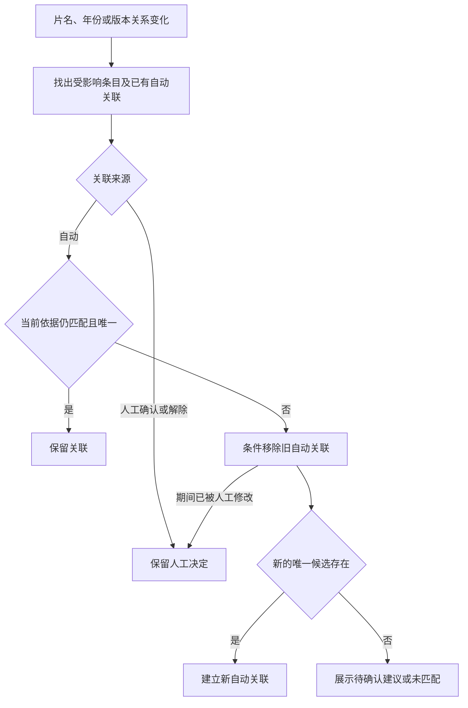
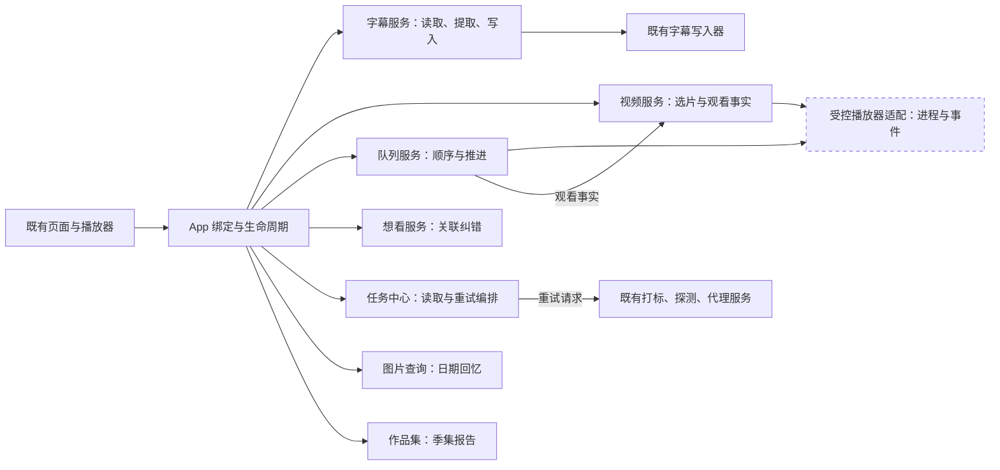

# 功能打磨与扩展 · 概要设计

状态：2026-10-22，用户已授权按本方案及推荐值实施，功能与公共接线已完成并通过独立审阅，最终集成自动化与合成媒体验收已通过。未提交、安装或部署；外置盘、SMB、exFAT 现场矩阵尚未验证。

详细规则、实现落点与验收见[需求设计文档](需求设计文档.md)。当前项目事实以 [AI-CONTEXT.md](../../../../AI-CONTEXT.md) 和现有代码为准，本稿不覆盖其中的已批准合同。

## 1. 目标与范围

让已经具备的能力接成完整流程：处理好的字幕能够直接观看，资料纠正后关联随之纠正，选片按作品去重，后台失败可以准确恢复；同时提供剧集完整度与照片回忆。

**D-F00 · Workflow Contract · 已接受并实施，集成自动化验收已通过，设备矩阵仍有限制。** 2026-10-21 用户要求出方案并排除手机遥控；2026-10-22 明确要求「按照这个来，分为 2 个 subagent 进行开发」，授权完整范围及推荐规则。此次授权涵盖开发、独立审阅和专用夹具验证，不涵盖提交、安装、部署或在真实片库上演练破坏性操作。手机遥控不进入任何阶段。照片地图仍待立项，不并入「那年今天」。入口依附现有播放器、任务中心、作品集和照片页。

立项依据分三类；下表的旧行为是修订前状态：

| 类型 | 事实 | 处理方式 |
|---|---|---|
| 已复现的一致性问题 | 视频更正片名、年份后，旧想看自动关联仍保留 | 修正自动关联的失效与再计算 |
| 现有能力缺口 | 两个应用内播放器未接同名外置字幕；普通 IINA 反馈有已记录的漏判场景 | 补齐字幕播放；另提供明确选择的精确播放反馈 |
| 已接受的产品规则变更 | 原随机和今晚看什么按文件抽样，同作品多个版本可能同时出现 | 现统一按作品抽样，旧选片、版本和队列合同已标明对应修订 |

## 2. 分阶段交付

下表保留原产品分期，A–C 的代码及公共接线现已一并实现；各项验证状态以末节和需求文档为准，不把分期表当作全部验收完成的证明。

| 阶段 | 内容 | 用户可见的完成标志 | 相对投入 |
|---|---|---|---|
| A：观看与数据一致性 | 应用内 SRT、想看自动关联纠错、作品级随机 | 同名字幕可显示；更正资料不继续打开错片；一批推荐不再包含同作品多个版本 | 中；已有 WKWebView 合成样片验证 |
| B1：失败恢复 | AI 视频打标、技术信息、播放代理的失败明细与选择性重试 | 失败超过 50 条仍全部可达；只处理用户选定且仍失败的媒体 | 中至大；涉及任务记录与两库迁移 |
| B2：播放与字幕利用 | 显式选择精确 IINA 播放、提取内嵌文字字幕 | 自然结束能够可靠反馈；已有字幕不必重新语音识别 | 大；IINA 生命周期与真机验收是主要成本 |
| B3：推荐反馈 | 暂时不推荐某作品、减少指定标签的推荐 | 用户能表达偏好、看到生效原因并撤销 | 中；先依赖作品级选片 |
| C：增量新功能 | 照片「那年今天」、剧集完整度 | 按真实拍摄日期回忆；看清编号空缺、同集多文件及离线集 | 照片小至中，剧集中 |
| 贯穿 A–C：可靠性 | 外置盘、SMB/exFAT、权限、恢复现场验证 | 区分离线、丢失与权限问题，删除和恢复结果与提示相符 | 取决于可用测试设备 |

实施仍沿用原有服务、队列、图库和作品集，不重写统一任务框架。可靠性验证贯穿各阶段；缺少真实测试卷的场景保留为未验证。

## 3. 核心体验

### 3.1 字幕从制作走到观看

详情和待播队列都读取现有同名 SRT，播放器提供字幕开关和仅影响当前播放的时间偏移。播放时转换为浏览器可用的字幕数据，不改原 SRT、不烧录视频，也不重新生成播放代理。字幕损坏、编码不支持时明确报告字幕失败；视频仍可观看，两种结果分开显示。

已提供「提取内嵌文字字幕」：先选择轨道，预览结果；已有同名 SRT 时按既有规则确认覆盖、备份后替换。图片字幕明确不支持，不偷偷转成语音识别或 OCR。相关规则见 [D-F01](需求设计文档.md#D-F01)、[D-F06](需求设计文档.md#D-F06)。

### 3.2 自动关联能纠错，人工决定不被覆盖

自动关联是从片名、年份和版本关系推导出的结果。输入变化后，需要检查已有自动关联是否仍成立，不能只给「尚未关联」的条目寻找新对象。人工确认、人工解除继续具有优先级；不会因为一次重算而消失，也不会新增榜单已看的同步副作用。

下面是自动关联处理流程；只有 auto 关系参与纠错。

读取也要验证自动关联，避免后台尚未重算时把已纠正的错片继续标为「已在库」。读取失败与没有匹配仍须区分。并发边界见 [D-F02](需求设计文档.md#D-F02)。

### 3.3 选片以作品为单位，观看记录仍以文件为单位

已确认版本组算一部作品，未分组视频各算一部。先确定符合筛选的可播放版本，再按作品抽取；每部作品只占一个候选位置。排除某个版本时，该组也退出本轮候选。「探索」不会因为另一版本没看过而再次推荐同作品。

播放次数、评分、收藏、断点仍保留在具体文件上，不进行历史数据合并。权重如何聚合、筛选如何取交集见 [D-F03](需求设计文档.md#D-F03)。推荐反馈只改变选片，不改收藏、标签、已看或全库搜索结果。

### 3.4 失败之后有明确下一步

任务中心保留摘要，同时提供分页失败列表。「重试所选」和「重试本次全部失败」只针对已确认集合；确认后新产生的失败不混入本次操作。已经成功、被删除、已在排队或文件已变化的项分别说明原因，不当作再次成功。

重试依旧交给原服务执行；任务中心不拥有新的调度器。只有失败明细与批次追踪需要补充记录。具体边界见 [D-F04](需求设计文档.md#D-F04)。

### 3.5 精确 IINA 播放是明确的播放器选择

保留系统默认打开方式与现有用户窗口。新增显式的「IINA 精确同步」选择，让应用仅管理自己创建的独立窗口，并使用实际播放事件同步进度。默认不自动切换，不以等待了多久推断看完，不把普通播放偷偷塞进或清空待播队列。

复用现有队列 IINA 的进程与 IPC 能力，但下一项仍归队列，普通播放不连播。生命周期及统计边界见 [D-F05](需求设计文档.md#D-F05)。

### 3.6 两项新功能

**那年今天：** 照片页提供往年同月同日的回忆，可按人物筛选，打开后沿用现有看图器。没有拍摄日期的图片不使用导入日期冒充；不自动读取定位、不接地图服务、不新增系统通知。日期与闰日规则见 [D-F09](需求设计文档.md#D-F09)。

**剧集完整度：** 在作品集里检查季集编号，显示「已识别」「编号空缺」「同集多文件」「已收录但离线」「无法识别」。例如只有第 1、2、4 集，可报告中间缺第 3 集；不知道总集数时不能说整季收齐。已有自动作品集识别继续作为建议，不自行合并版本、改顺序或下载缺集。详见 [D-F08](需求设计文档.md#D-F08)。

## 4. 模块边界

下图表示当前调用方向；方框内是既有责任的扩展，不代表另起服务进程。虚线框「受控播放器适配」从现有队列 IINA 实现提取，不持有队列、观看或推荐数据。

App 不写业务表；前端不推导批量操作的完整集合。字幕错误只影响字幕通路；推荐错误不改变播放历史；某个失败项重试失败不回滚其他项；播放器控制错误不得推进队列。后台登记表继续只负责运行状态，不把它改成持久化任务真值源。

## 5. 已接受的产品选择

以下推荐值已随 2026-10-22 的实施授权接受，并在代码中落实。

| 选择 | 当前规则 | 影响 |
|---|---|---|
| 作品级探索与权重 | 可访问的未删除版本任一看过，作品就算看过；含离线历史。取成员最大衰减播放分数，每作品一次抽样 | 替代旧随机合同的文件级抽样；文件事实不合并 |
| 推荐反馈时效 | 作品暂避 7 天；指定标签降权到 0.5，直到撤销；多个标签不连乘 | 影响选片结果，需要提供查看与撤销入口 |
| IINA 精确同步 | 显式选择的独立窗口，初始仍沿用原播放器偏好 | 增加受控窗口体验，不替换用户既有默认行为 |
| 季集信息 | 首版提供可纠正的季集归属及可选手填总集数，不在线推断 | 增加少量维护能力，避免把文件名推断当真值 |
| 照片回忆 | 只取往年同月同日；2 月 29 日仅在闰日展示 | 范围小、结果可解释，不自动扩成「这一周」 |

## 6. 验证与交付状态

功能与公共接线已由两位开发者交叉独立审阅，发现的字幕确认取消、受控进程关闭失败、失效反馈、冻结重试源及大集合查询问题已修复并复核。已完成 SQLite/PostgreSQL 定向行为与并发测试、五张新表实际数据往返、旧结构升级、SQLite 真实备份恢复，以及专用容器工具执行的真实 PostgreSQL 备份恢复；最后一项不代表宿主已安装原生 PostgreSQL 工具。

最终集成副本已通过全量 `go test ./...`（根包 45.916s、services 170.089s）、前端 `npm test`（195 文件、3,008 测试及全部守卫、485 个绑定均有调用方）、`go vet ./...`、关键生命周期 race、`--build-only` 构建，以及真实 WKWebView、IINA 合成媒体（27.065s）和 PostgreSQL 新行为/非空迁移/真实备份恢复专项（21.956s）。构建未安装应用。外置盘拔插、SMB、exFAT、系统权限等设备相关矩阵未完成，不把合成媒体与自动化通过等同于所有现场验收完成。

详细场景、实现落点与设备限制见[验证与交接](需求设计文档.md#verification)和[实施记录](../../plans/2026-10-22-functional-polish.md)。
