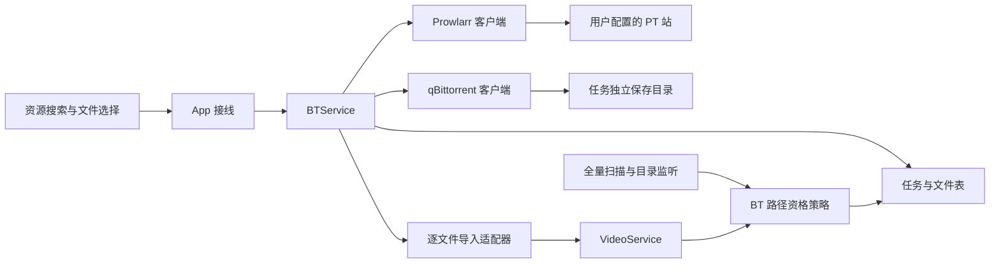
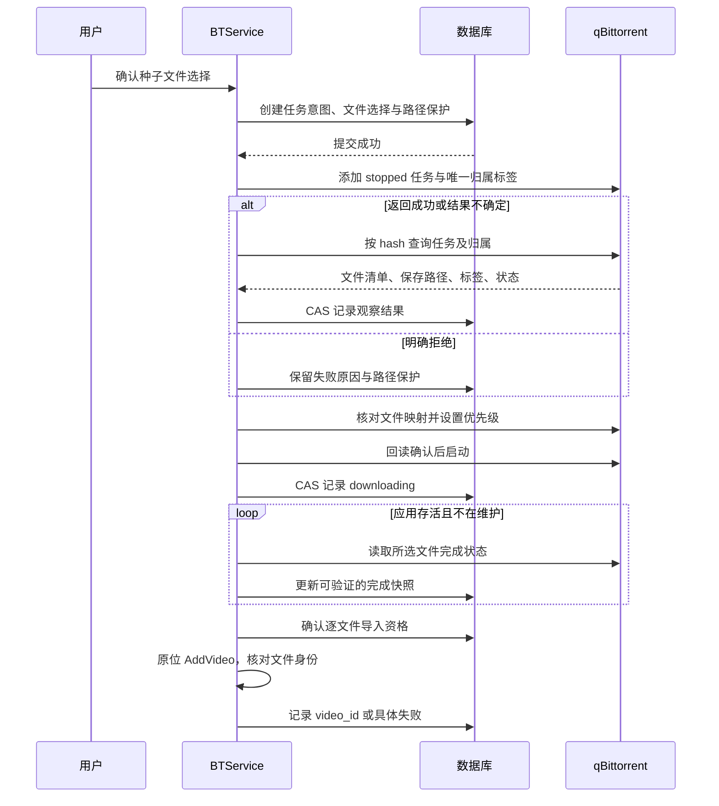

# Prowlarr 资源搜索与本机 BT 下载

状态：已按用户授权完成代码集成，独立审阅的 Critical / Important 问题已关闭；最终回归核对见[验证记录](验证记录.md)。本文拥有 D-PT-01..03，精确字段及安全合同见[详细设计](需求设计文档.md)，执行过程见[实施记录](../../plans/2026-10-30-prowlarr-download.md)。真实站点配置与下载尚未验收。

## 用户确认的结果

2026-10-31 增强请求：资源入口默认展示站点最新内容，搜索结果展示封面；观看区「片单」增加「资源」标签，可直接浏览、搜索和选择文件，不必进入管理台。继续保留下载页入口与已有的文件选择、归属和入库合同。最新内容是本轮各站点返回结果按发布时间倒序排列，不代表站点全部历史；没有封面或图片读取失败时保留文字和操作。

2026-10-30 用户要求把多个 BT 站的资源发现、下载、入库和观看串起来，举例 MT、NicePT。MT 暂按 M-Team 理解，具体站点以用户在 Prowlarr 配置的实例为准。用户明确选择：

- Prowlarr 聚合站点，本机 qBittorrent 执行下载。
- 下载前可逐项勾选种子文件，也可一键全选。
- 完成后在下载位置直接入库，保留目录、文件名及做种文件。

## D-PT-01：职责与复用边界

Behavior / Architecture Contract；以上产品选择已确认，下列模块落点为实施设计。

| 组件 | 职责与现有扩展点 |
| --- | --- |
| CineInsight 资源入口 | 从片名发起搜索、展示站点与版本、文件选择、任务进度及播放入口。想看片单条目继续保留，不因下载自动删除。 |
| Prowlarr | 持有站点配置和站点凭据，负责搜索与取种。CineInsight 连接其 API；站点登录在 Prowlarr 完成。 |
| 本机 qBittorrent | 持有下载、校验及做种事实，按所选文件优先级执行。CineInsight 只管理自己创建并有持久归属记录的任务。 |
| 新 BT 协调模块 | 持久化提交意图、种子标识、文件选择和逐文件入库结果；重启对账。本模块不实现 BT 协议。 |
| 现有 VideoService | 复用 AddVideo 和既有视频身份/重复路径处理、技术探测及新入库观察者。引入逐文件完成资格校验，接入扫描路径，防止扫描器提前收录未完成 BT 文件。 |

BrowserDownloadService 只支持 HTTP/HLS，拥有 ffmpeg 进程与网络流下载状态，其重启 interrupted 语义不适用于外部 qBittorrent 持续运行的任务，因此不将 BT 伪装成浏览器下载。其 BrowserDownloadImporterFromScan 调用 SyncAffectedDirectories 扫整个目录，不能直接用于选择性 BT 入库。下载页可共用导航和展示，但 BT 的运行事实以 qBittorrent 为准。

依赖方向：UI → App 接线 → BT 协调模块 → Prowlarr/qBittorrent 客户端；完成文件通过注入的库导入能力进入 VideoService。客户端不依赖 UI、扫描器或数据库。没有新的媒体重编码流程。

## D-PT-02：文件选择与下载状态

Behavior / Workflow Contract；用户已确认文件可选。

1. 搜索结果选择资源后读取种子元信息，展示相对路径、大小、视频/字幕等类型及总计；空选择不能开始。
2. 未确认选择前不能开始下载整个种子。元数据尚未就绪时显示等待，不能擅自改为下载全部。
3. 任务提交采用独立归属标识；已有同 hash 的用户任务明确提示，不改变它的分类、路径、文件优先级或运行状态。
4. 提交超时属于结果不确定：先按归属与 hash 核实，不盲目重复添加。添加、设文件优先级、启动分别核实结果；未完成选择的任务保持停止。
5. 进度按选择的文件计算；跳过的文件不要求完成。校验中、移动中、错误、缺文件与服务不可达分别呈现。
6. 应用退出不停止 qBittorrent 做种；重新打开后恢复对账。用户在 qBittorrent 手动改动选择/路径时先标明不一致，不自动覆盖回旧配置。

API 字段须以已安装版本验证：本机调查发现 qBittorrent 5.2.3；Prowlarr API v1 搜索与取种。连接凭据仅后端使用，UI状态及日志不回显密码、API key、passkey或带签名的完整下载链接。

## D-PT-03：完成后原位入库

Behavior / Data Contract；用户已确认保留原目录和文件名做种。

- 仅对本应用任务中已选择且完成校验的实际视频文件发起导入；非视频附件和未选择文件不建视频记录。
- qBittorrent 上报完成与文件存在都要验证；路径须落在该任务已确认的保存根内，拒绝路径穿越和逃逸符号链接。不信任种子中的绝对路径。
- 原位入库只增加库记录，不移动、重命名或删除做种文件。修改片库封面、标签等不得改写种子内容。
- 完成资格必须覆盖全量扫描、目录监听、补扫及手动重入库路径。不能只在新下载页拦截，而让目录监听提前收录半成品。
- 下载完成与导入完成分开；逐文件记录已入库ID/失败原因，重试只处理未完成导入。多文件部分失败应可见，已有记录按路径复用，不重复建库。 新建或恢复的记录在最终资格核对前保持不可见；首次发布进度持久化在原文件行，退出后可继续，恢复旧记录不冒充新入库。
- 扫描目录授权沿用既有边界。未覆盖的下载位置需在配置中明确选择纳入片库，不悄悄扩大其他目录的扫描范围。

## 验收场景

| 场景 | 可观察结果 |
| --- | --- |
| 搜索片名 | 汇总配置站点的资源；一个站点失败可识别，结果不冒充全量成功 |
| 单文件、整季、多文件选择 | 确认前展示范围；启动后只有所选文件需要下载 |
| 同一资源重复提交、网络超时、应用重启 | 可对账，不生成重复任务、不接管原有用户任务 |
| 同目录一部完成一部未完成 | 只导入完成的所选视频；扫描器与监听器不能提前收录另一部 |
| 部分入库失败 | 下载仍显示完成，具体文件可重入库，不重下已完成内容 |
| 做种期间入库 | 文件目录、名称和内容哈希不变；qBittorrent继续做种 |
| 无凭据、认证失效、服务关闭 | 明确配置/认证/连接错误，无密钥泄露 |

## 实施与环境边界

- 本机已有 qBittorrent 5.2.3 / Web API 2.15.1；原用户实例仅作只读调查，未修改其配置或任务。
- 用独立 profile、loopback peer 和合成 torrent 验证元数据停止条件、v1/v2/hybrid 布局、选择性下载及原位入库；系统凭据测试使用注入后端，未读写用户实际 Keychain 秘密。
- 应用、设置、片单、下载页、任务中心和维护生命周期已接线。SQLite/PG 模型迁移及恢复有专项验证；具体命令、范围与最终结果见[验证记录](验证记录.md)。
- 未安装 Prowlarr、未配置真实 PT 账号、未下载真实影视资源，未安装或部署本次应用，也未提交或推送代码。真实站点搜索/取种与整机 GUI 仍需对应环境验收。

## 权威接口资料

- Prowlarr OpenAPI：https://raw.githubusercontent.com/Prowlarr/Prowlarr/develop/src/Prowlarr.Api.V1/openapi.json
- qBittorrent Web API：https://github.com/qbittorrent/qBittorrent/wiki/WebUI-API-%28qBittorrent-5.0%29
- 本地复用证据：services/browser_download_service.go::BrowserDownloadImporterFromScan、services/video_service.go::AddVideo、AI-CONTEXT.md §2.27 与 §2.29。

Support lenses：architecture-designer（职责与复用）、api-designer（最小响应和失败语义）、sql-style（SQLite/PG兼容及CAS）。

## 组件关系与外部事务

下图是当前依赖方向；BTService 是唯一协调者，qBittorrent 是下载事实源，数据库只持有本应用意图、归属和导入结果。

外部调用不放在数据库事务中。超时后的空查询不能证明任务从未添加；结果不确定时只对账，不自动重放添加命令。恢复备份、切换数据库或换 qBittorrent 端点后先冻结远端写操作并对账，避免把旧快照重发成新任务。

## 设计裁量与尚需验证的边界

技术方案采用每任务独立子目录（原始种子内相对路径不变），先持久化目录保护，再添加停止任务。这样即使 qBittorrent 提前创建未选择文件、程序在任一步崩溃，扫描器仍可识别这批文件属于受控下载。具体扫描接线、保留路径墓碑和回滚约束见 D-PT-06。

Prowlarr 的 POST search 会直接提交给它配置的下载器，因此文件预览阶段只用搜索和取种代理。代理链接含密钥，留在后端；返回前端的是短期不透明结果令牌。磁力结果需要 qBittorrent 的 MetadataReceived 停止条件，必须用目标版本验证“取完元数据即停止、无影片负载下载”，无法满足时明确拒绝该结果，不悄悄开始整包下载。

部署边界仍为本机 loopback。Prowlarr 的安装及站点凭据配置尚未执行；隔离合成测试只证明记录中的客户端版本与代码路径，不替代真实站点验收。用户确认的产品选择与实现期技术裁量按本文及详细设计区分记录。
