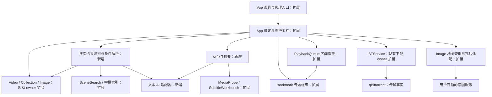
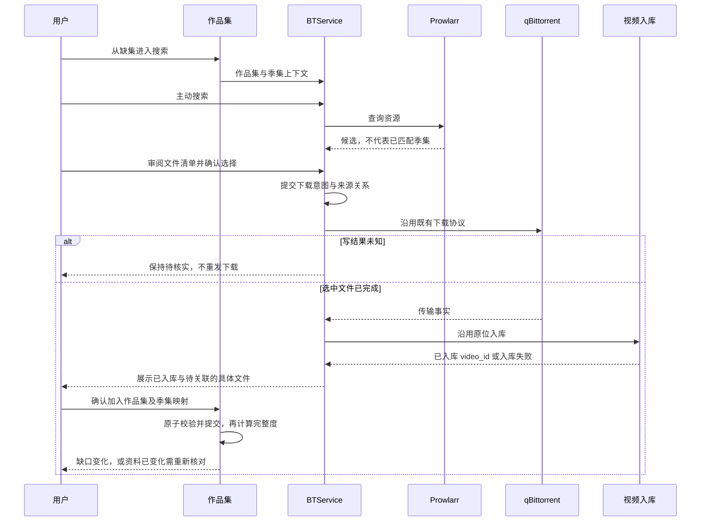

# 片库体验完善与内容探索 · 概要设计

状态：2026-11-04，v1.0，accepted，已实现并完成本机验收（既有失败与外部环境边界见实施记录）。用户在完整方案交付后明确回复“开始吧，方案没问题”，整体批准本方案并授权实现与验证；不包含提交、安装或部署。原 v0.1 的 proposed 标记记录提出时状态，均由本次整体批准取代。

详细合同与验收：[需求设计文档](需求设计文档.md)。现行权威入口：[AI-CONTEXT](../../../../AI-CONTEXT.md)。本文不修改现行领域合同，接受并实施后才将对应行为更新到领域文档。

## 1. 来源与范围

2026-11-03 用户在九项建议后回复：“嗯，这些功能我都很需要，你帮我spec出方案吧”。原请求交付完整设计；随后用户以“开始吧，方案没问题”授权开发与验证，仍不包含安装、提交、推送或部署。

| 来源编号 | 用户确认的方向 | 本次设计对应的可观察结果 |
|---|---|---|
| R-01 | 缺集到补齐 | 从作品集缺集进入资源搜索，核对文件，下载入库后回到作品集完成关联 |
| R-02 | 字幕观看体验 | 调整字幕显示样式，浏览同步台词并跳转 |
| R-03 | 检索结果浏览 | 汇总不同类型结果，按影片浏览多个命中并连续预览，返回保留条件 |
| R-04 | 推荐偏好 | 明确表达正向偏好，使用场景预设，看见并管理推荐影响 |
| R-05 | 首次使用与能力准备 | 根据使用目标看见可用能力、缺少条件和明确的下一步 |
| R-06 | 自然语言组合搜索 | 将一句话解析为可修改的筛选条件，以真实片库数据返回结果 |
| R-07 | 照片地图与旅行回顾 | 按地点、日期与人物浏览照片，形成选定日期范围的回顾 |
| R-08 | 片段专题集 | 跨影片收集、排序、批注和连续播放片段 |
| R-09 | 章节导航与时间点摘要 | 读取已有章节、手工编辑章节、显式生成可校对且能回跳的摘要 |
| R-10 | 大片库搜索评估 | 测量当前查询与候选索引，证明结果语义一致后再决定是否改变引擎 |

R-10 是上轮建议附带的评估工作，纳入本方案；它不意味着已承诺采用 FTS5 或更换数据库。没有独立 PRD 或原始 AC/TC 编号，上表保留源需求，详细设计以具体场景对应，不伪造已批准的验收编号。

**D-LE-00 · Workflow Contract · 范围已确认，细则 proposed。** 来源为上述用户原话。九项功能均保留在整体交付范围；分期只安排先后，不能把后期写成取消。下游实施必须同时阅读本节原始需求、下列用户裁定及详细合同，不能仅按功能编号完成任务。

### 已确认的产品边界

**D-LE-01 · Behavior / Data Contract · 用户已确认。** 用户对 Q1 选择：“本地管理照片与坐标，用户开启后加载联网底图；不接在线地名查询”。地图服务商仍能知道被请求的地图区域及网络连接信息。照片、人物关联和坐标清单不上传；不以地图授权扩大其他联网能力。

**D-LE-02 · Behavior / Data Contract · 用户已确认。** 用户对 Q2 选择：“允许作为显式启用的可选能力，调用前说明发送范围”。自然语言搜索可发送用户查询文本；自动章节摘要可发送所选视频字幕。默认不发送视频、图片、文件路径或完整片库。已有 AI 打标配置不代表用户已启用这两种新用途；不恢复已经退役的外部字幕翻译引擎。具体启用、取消和结果隔离见详细合同。

## 2. 设计重点

已有能力的事实依据见详细设计的[架构适配](需求设计文档.md#evidence)。特别注意三处边界：

- 搜索已经有“查看全部”和场景检索页。本次扩展现有入口，增加汇总、影片分组和片段预览，不平行建设另一套搜索索引。
- 想看片单已经能“找资源”，作品集已经能报告缺集。本次把季集上下文传给现有下载流程；不会因检测到缺集就自行下载。
- 书签拥有正文与源版本，队列拥有播放会话。专题集保存书签关系和排序，播放仍交给队列；章节和摘要也通过既有播放器定位。

**D-LE-03 · Interface / Data Contract · Proposed。** 来源 R-01–09。新增体验复用现有领域 owner；App 只负责连接和生命周期。新增持久实体仅服务新的用户事实，不另存一份片库、下载状态或字幕正文。下游须遵守下图依赖及详细设计中的新旧数据关系。

下图是拟议职责，箭头表示调用；“扩展”与“新增”标明本次变化。公共维护围栏约束所有路径，外部故障只影响请求它的功能。

不把新需求统一塞进一个“智能中心”。搜索编排不写片库，文本 AI 不执行 SQL 或工具，地图不拥有照片副本，准备引导不拥有任务队列。

## 3. 用户看到的流程

### 3.1 缺集补齐

作品集的缺集行提供“找这一集”，范围缺口提供“选择要找的集”。带作品集标题、季集号进入资源页；用户可以改搜索词。资源标题只产生“可能包含”提示，实际选择以文件清单为准。已经在库、离线和正在下载分别展示，不把离线当缺失，不把名称相似当精确匹配。

下图为拟议跨系统顺序。只增加来源记录与入库关联审阅，外部任务状态沿用 BTService 合同。

不会自动覆盖人工季集编号，也不会因为搜索时缺一集，就把后来新出现的全部文件纳入操作。

### 3.2 搜索与自然语言

⌘K 保留既有快速跳转及其播放语义；“汇总结果”进入同一搜索体验，既有场景页成为画面和台词的专业浏览入口。按影片分组的结果保留每一段命中的时间、来源和证据。新结果页的单条与连续“预览”均走统计中立的区间队列；明确点“观看整片”才结束预览并创建正式播放会话，不把既有详情播放器直接当作中立预览。

自然语言是独立的“解析条件”动作，不让每次输入都调用模型。普通搜索、本地条件解析、外部 AI 解析是用户可见的模式。模型返回条件草稿；人物、标签等 ID 在本地解析，重名要求选择，不能理解的部分明确列出。用户检查条件后搜索，不静默丢弃条件扩大结果。

例如“没看过、两小时以内、张国荣的片”：显示“未看”“≤120 分钟”“人物：张国荣”。当前人物关系没有演职角色，输入“出演”时提示只能按人物关联筛选；未确认这项语义转换前不能执行一个冒充“出演”的查询。

### 3.3 字幕与长视频

播放器字幕菜单增加字号、背景和位置；侧栏“台词”与当前播放时间同步。时间偏移只改变显示和定位投影，不改 SRT 文件。点击台词跳到偏移后的起点，切换视频或字幕后不能复用旧行。

详情页“章节”展示文件原有章节与用户整理的章节。自动章节摘要由用户显式发起，使用选定字幕，在任务中心显示进度。生成内容先是草稿，用户审阅后保存；失败不覆盖旧章节。所有视频的摘要默认收起，用户自行展开，避免依赖并不存在的可靠电影类型判断。

### 3.4 专题集与照片地图

在书签、场景结果和视频详情里“加入专题”，形成跨影片有序列表。点“连续预览”将选定区间加入现有队列；只在本次确认的片段内连续前进，最后一段结束必须停止，之后追加的整片不会被顺带播放。源文件变化则停住并要求核对。编辑书签影响专题中的同一书签；已经入队的区间使用入队快照，不中途改变。

照片页新增地图模式；地点聚合和人物/日期过滤在本地执行。旅行回顾第一版由用户选日期范围和人物，按真实拍摄时间展示照片与位置。它不推断用户住址，也不把两张照片之间的连线称为真实行程。没有 GPS 的照片仍出现在回顾时间线，有 GPS 而无日期的照片可出现在地图但不伪造旅行日期。

### 3.5 推荐与准备引导

推荐预设直接组合已有“探索、重温、仅收藏、时长”条件，不创建第二套抽样器。正向偏好先支持“多推荐此标签”，与已有“少推荐”在同一个偏好入口切换；查看影响理由并恢复中立。

准备引导按“看片、整理片库、搜画面、制作字幕”展示步骤和当前能力。打开引导只读状态；下载模型、建立索引或发起扫描仍由用户点击原有动作。可以跳过，以后从设置或命令面板回来。

## 4. 交付顺序建议

| 批次 | 保留的完整范围 | 依赖与价值 |
|---|---|---|
| A 高频流程 | R-01 缺集补齐、R-02 字幕体验、R-05 能力准备 | 尽快连接现有功能；字幕投影为后续台词与章节提供一致基础 |
| B 搜索与选择 | R-03 汇总检索、R-04 推荐偏好、R-06 自然语言搜索、R-10 性能评估 | 共享筛选与结果表达；先有语义一致性证据再选索引 |
| C 内容组织 | R-08 专题集、R-09 章节与摘要 | 依赖区间队列、源版本与文本 AI 边界 |
| D 照片探索 | R-07 地图与旅行回顾 | 技术上可独立；网络边界已确认，具体底图方案见详细合同 |

这不是执行计划或工期承诺；四批均在本次功能方向内。专题和章节共享播放修改，集成需顺序处理；数据库模型清单、Wails 生成结果和全局导航也是共享修改点。

## 5. 兼容性与交接

字幕仍是 Apple 系统生成/翻译和同名 SRT，现有字幕备份规则不变。SQLite 和 PostgreSQL 都能使用本次新增业务能力；既有 pgvector 语义检索的后端限制不改变。手机网页、Jellyfin 和浏览器插件协议不在本次新增界面范围；它们已有观看与安全行为受保护。

本次读取工作区时存在资源详情功能的未提交修改；它们是当前参考基线，不代表已发布。本方案不修改这些文件，也不把继续开发资源详情并入本次范围。

用户层面两项关键选择均已答复。完整方案及专题区间统计中立、入库后的人工关联审阅、自动摘要草稿等细则已随本次整体批准生效。技术风险、验收与真实检查记录见详细设计的[验证与交接](需求设计文档.md#verification)。
