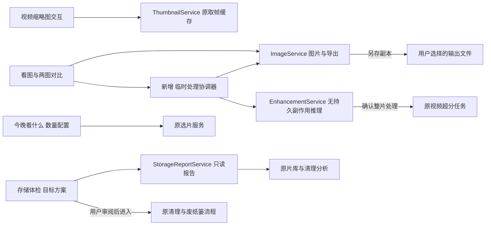

# 看图处理与空间治理 · 概要设计

状态：产品范围与原图保护方式已由用户确认；技术设计记录实施选择；八项已实现并完成本机验证，最终范围以[实施记录](../../plans/2026-11-04-media-utility.md)为准。来源：[需求](../../../../.loopx/intake/2026-11-04-media-utility/requirements.md)。精确边界与验收见[详细设计](需求设计文档.md)。

## 现有基础与改动范围

本轮完整覆盖八项需求。图片体验接在 `PhotoLightbox` 与图片管理的查看/选择入口；候选数量接在 `TonightPickerDialog`。后者后端 `VideoService.SuggestTonight` 已支持1～12，继续用此上限与默认6。视频缩略图复用 `ThumbnailService` 的取帧、精灵图与缓存，不建立第二套视频分析任务。

空间方案由既有 `StorageReportService` 扩展只读数据，候选来自已有视频/图片清理结果与久未观看清单。保留覆盖和“本组不删”实际由原前端清理页持有，必须取得它们的有效审阅快照，不能从后端分析猜测。原清理流程继续拥有保留锁、逐项复核、废纸篓、撤销与部分失败。图片来源与导出由 `ImageService` 及图片 App 边界负责；增强继续由 `EnhancementService` 拥有固定模型和无持久副作用的推理原语。

**D-MU-01 · Behavior / Interface Contract · 实施选择（AC-01..08）**：沿用上述业务所有权，不新增业务数据库、云接口或第二套清理/推荐引擎。新增窄的`MediaProcessingService`只持有本轮临时处理请求、取消句柄和临时产物，理由是现有ImageService没有异步会话生命周期，而持久视频超分不能充当临时图片/样片任务。该协调器不拥有片库和模型，也不写持久超分任务；重启无需恢复未保存会话。App显式将它接入任务、关闭、维护与恢复握手，新增App入口必须有真实前端消费者，并按既有生成方式更新绑定。唯一owner与接口见详细设计。

下图表示本轮扩展点和调用方向；原片库与原文件始终是事实来源，临时预览均可丢弃。

## 图片从浏览到处理

**D-MU-02 · Behavior Contract · 实施选择（AC-01/02/04）**：缩放/平移使用同一视口计算，适应尺寸、1:1、滚轮锚点、临时放大与双图联动共享数学定义。双图以归一化焦点联动，原始像素尺寸不同仍各自显示真实倍率。编辑参数与撤销历史属于当前图片会话，换源或退出先处理未导出修改；明确放弃才清空。原图对照仅改变显示，不能覆盖参数。相邻预加载与对比不会走正式查看计时。

**D-MU-03 · Data / Operational Contract · 用户确认（AC-02/03/08）**：处理结果先作为副本预览与另存；任何处理不得覆盖、移动或删除原图。新文件写入必须使用临时文件并校验后发布，不覆盖现有目标，不允许通过符号链接或同文件别名绕过原图保护。只有用户对明确原文件另行确认，才由原清理服务处理。处理失败保留原文件；导出成功后不得因入库失败反删用户已保存文件。

## 压缩与增强分开定义

**D-MU-04 · Behavior / Data Contract · 用户确认及实施约束（AC-03）**：无损只指图片。对可证明保真的格式进行熵编码/容器优化，验证可见与透明像素、尺寸、方向、色彩和元数据。无法证明的格式不处理并明确说明，不能静默转JPEG、降位深、删ICC或只保留动画首帧。产物不更小时返回“没有进一步压缩空间”，不生成占空间的等大副本，不承诺压缩率。格式能力与工具是否就绪必须在开始前可见，具体格式验证见详细设计。

**D-MU-05 · Behavior / Operational Contract · 实施选择（AC-08）**：图片局部试处理和视频短样片使用原运行时与固定general/anime参数，独立于正式成品发布。图片预览注明局部范围，视频区间须在已知片长内。原片与样片等比例/同步位置对比；样片不写断点、已看或播放事件。试处理、取消和再次选择以请求身份隔离；整片按钮仍明确创建原超分任务，不把试处理自动升级。推理与现有整片超分串行，临时结果有数量/体积上限，关闭、维护、源变化和退出使其失效并回收。不外发媒体。

## 按目标审阅空间

**D-MU-06 · Behavior / Interface Contract · 实施选择（AC-07）**：用户选择实际磁盘并输入希望额外释放的容量。只读方案逐项列出原因、大小、保留对象与处理入口；同一物理文件在多个类别或路径中只能计一次，跨盘副本不能算成当前盘的回收量。精确重复优先，近似重复/多版本/长期未看只作待审阅候选，不自动勾选。先保留已有清理保留锁，收藏或评过分的候选明显标注。候选不足时显示缺口，不为了凑目标放宽来源范围。

方案表示当前数据的审阅建议；真正执行依旧调用各原owner重新核对，不新增“执行方案即按旧ID直接删除”的路径。逻辑大小、可回收估计和实测可用容量分开，废纸篓与APFS共享块等导致实际变化小于估计时如实说明。目标输入单位GB按10^9字节，显示GiB时明确单位，避免混用。

**D-MU-07 · Behavior Contract · 实施选择（AC-05/06）**：视频缩略图只对当前交互卡片有界取帧，换源/离开即撤销迟到结果，失败保留原封面与说明；点击明确时间点才进入原预览。今晚看什么仅将1～12候选数持久化到独立本机偏好，非法输入不调用后端、不覆盖上次合法值，不把数量混入随机播放条件。

## 风险与验证状态

**D-MU-08 · Operational Contract · 已实证的依赖修复（AC-08）**：真实试处理发现旧sidecar依赖Homebrew Vulkan Loader，现有MoltenVK portability驱动未被旧实例创建方式枚举，报`vkCreateInstance failed -9`。隔离副本改为随包直接加载MoltenVK、清除Vulkan环境变量后，普通/动漫图片与视频样片均通过。采用直接加载并随包分发MoltenVK及许可的路线，不发布把portability标记伪装为false的诊断JSON，不改用户全局环境；依据[SDK对macOS直接随包分发MoltenVK的说明](https://vulkan.lunarg.com/doc/view/1.4.357.0/mac/getting_started.html)。

运行时身份升级到`realesrgan-ncnn-vulkan-v0.2.0-cineinsight2`，清单包含二进制、驱动和许可SHA-256；保留原两模型、权重校验及2×输出。旧版本保留进度按原有运行时不匹配规则拒绝续跑，不静默换模型或拼接不同运行时成品。实际发布包须验证驱动装配及整体签名，不能以Homebrew存在代替。

原文件保护、无损证明、清理候选有效性和临时媒体路由属于需要独立审查的风险面。普通视口计算、数量配置和静态缩略图不新增审批边界。设计后按[实施计划](../../plans/2026-11-04-media-utility.md)推进，不能把本文件或已有功能当作实施完成证据。

实现与独立只读审查已经完成；审查发现的保护状态、临时生命周期、可见范围、内存上限与前端关闭/样片同步问题均修正并复核。完整验证、原始基线与剩余环境限制以[实施记录](../../plans/2026-11-04-media-utility.md)为准，不把设计推演视为执行证据。

**D-MU-09 · Operational Contract · 随包JPEG工具兼容修复（AC-03）**：最终包实查发现开发机Homebrew的jpegtran与libjpeg最低系统为macOS27，不能作为项目macOS15发布能力。固定libjpeg-turbo 3.2.0源码，以macOS15/arm64和JPEG8 ABI单独构建到`build/image-tools`，打包默认只读取该产物；二进制与依赖均检查实际Mach-O最低系统版本，拒绝高于15或无法核对的组件，不通过修改load command假装兼容。构建和依赖参数遵照[上游构建说明](https://github.com/libjpeg-turbo/libjpeg-turbo/blob/3.2.0/BUILDING.md)，采用2 jobs；仍保持相同系数域优化与逐像素/元数据校验，不改系统Homebrew安装。源构建是开发打包前置步骤，日常应用启动不下载或编译工具。
