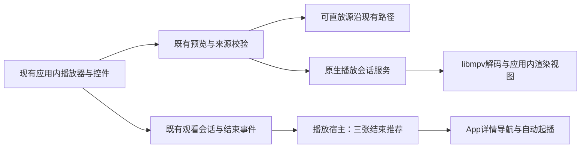

# 动态发现、播放结束推荐与老格式即播

状态：用户2026-11-05认可方向并要求拆分计划与实现，2026-11-06完成本轮交付。业务合同由本设计拥有，实际通过范围和既有失败见[执行记录](../../plans/2026-11-05-discovery-playback.md)；不把测试样本性能外推为所有文件保证。

来源：2026-11-05当前会话。用户希望精彩片段/频道等能力不依赖手工补章节；“今晚看什么”展示更多，首页不要一成不变；应用内播放结束显示随机三个视频，点击进入对应详情并自动播放；支持AVI、RMVB等老格式。上一轮5b2e8ee已按只push不部署处理；本轮实现授权不包含新的Git提交或安装。

## 实施前证据（2026-11-05）

- [HomePage](../../../../frontend/src/components/viewer/HomePage.vue) 的 HOME_TONIGHT_LIMIT=3。推荐批次主要通过“换一批”重抽，已播放推荐单项补位；大图有heroLock。用户这次要求改变首页推荐更新体验，原固定展示规则不能否定新需求。
- [app_discovery](../../../../app_discovery.go) 的SuggestTonightVideos是已有选片入口；[video_random](../../../../services/video_random.go)持有随机选片逻辑及单次50项上限。新的首页与结束推荐应复用可见性、版本聚合、偏好和排除合同，不能另建候选来源。
- [InlineVideoPlayer](../../../../frontend/src/components/player/InlineVideoPlayer.vue)的handleEnded目前上报观看完成，没有结束推荐层。详情、书签区间、探索预览和队列有不同用途，不能把区间结束、源失败或卸载都当作整片播完。
- [preview_direct_play](../../../../services/preview_direct_play.go)与[preview_service](../../../../services/preview_service.go)已有直放/兼容代理分流；大代理会走手动路径。现有完整代理不能单独满足这次首次短暂缓冲即播目标。尚未拿实际AVI/RMVB文件复现用户观察，因此不认定某个具体文件的失败原因。
- [章节合同](../../../context/ai-subtitles.md)：已支持读文件自带章节，以及字幕驱动的章节摘要草稿。摘要当前需展示提供方、输入规模后确认，不自动转写或外发媒体；用户希望“自动准备”尚不等于授权无人值守调用外部模型。

## D-001 更多且会更新的推荐

**整体方向已认可，以下采用为设计默认值。** 首页“今晚看什么”默认9项，增加“发现更多”独立入口，每批12项。入口从首页和视频页均可进入。两处共用原选片能力，适合在没有人物、章节或人工标签时使用。

首次进入生成一批；离开首页后再次进入时补充新候选，每次返回优先轮换三分之一，收到实际播放开始事件后单项补位。当前浏览期间不按定时器突然重排；主动“换一批”仍可用。首页推荐大图随明确的新批次更新，保持所在区块滚动锚点。最近展示排除限本次应用会话；完整浏览轮次耗尽后只清自动曝光的软排除，再开一轮，当前批次及用户硬条件保持。候选不足如实少展示/提示。

首页负责展示批次与锚点，选片服务负责候选与权重；App持有会话内最近展示的有界集合，不落库。先不新增跨会话曝光账本；若后续需要长期避免重复，再单独定义持久化和清理规则。

## D-002 播完后让用户选择下一部

**三张随机推荐、点击详情自动播放已确认。** 正常整片播放结束后，播放器画面内展示三张卡及“重播”；用户选择才跳转，不倒计时替用户自动选。推荐排除当前作品及本批重复项，遵守现有可见性/过滤，实际候选不足三项时显示真实数量。推荐只读取元信息和缩略图，不提前播放或记观看。

结束事件由播放器上报，当前详情/预览宿主复用选片服务请求推荐并发导航意图，由App沿现有详情自动播放链路完成切换。返回/换片/卸载使旧推荐请求失效；新片可见性变更时解释错误并保留选择，不跳到其他片。起播位置沿用现有续播规则，除非用户另行指定从头。

队列中间项继续按原队列顺序，队列耗尽后才展示结束推荐；书签区间/探索短预览停止不弹整片结束推荐。队列结尾以服务端确认的耗尽事实为准，不能只看已加载列表的最后一项。

## D-003 老格式首次短暂缓冲即播

**体验目标已由用户明确确认。** 保留原文件、应用内界面与导航。必须实测首帧、声音同步、任意拖动、暂停恢复、字幕、全屏、换片停止及结束事件，不能只用“解码器支持该扩展名”认定完成。

| 候选路线 | 收益 | 主要代价/待验证 |
| --- | --- | --- |
| 嵌入原生解码播放内核（优先验证） | 直接读取源文件，无需整片转换，方向贴近桌面播放器体验 | Wails视图内嵌、Web控件叠层/焦点、字幕、全屏、分发签名和运行时依赖需验证；不得变成外部播放器窗口 |
| FFmpeg分段即时转换与播放 | 可继续使用现有Web播放器；无需等待全部片段生成 | 首帧/实时转换速度、拖动到未转换位置、音轨/字幕映射、临时缓存与进程清理需验证；依赖转码性能 |

[mpv官方文档](https://mpv.io/manual/stable/#embedding-into-other-programs-libmpv)提供libmpv嵌入接口；[FFmpeg官方格式文档](https://ffmpeg.org/ffmpeg-formats.html)定义HLS分段输出。这些只证明存在技术路径，不证明本项目已达成性能与集成目标。当前机器能找到FFmpeg，尚未发现标准路径下的mpv命令/libmpv产物。

详细设计选择libmpv render API作为原生路线，先完成与Wails视图和现有控件的集成验证；该验证通过前不接生产路由。若无法满足控件/字幕/全屏要求，回到设计比较，不暗中切换为完整代理或另开外部播放器。原有PreviewService继续拥有资源校验和路由，原观看会话持有统计；新增解码/流会话仅持有播放资源，不能另写观看事实或修改原片。正在播放的源发生变化、退出维护、用户换片时，播放资源必须能准确停止并释放。

下图为采用的设计边界；原生视图合成技术验证尚未执行，既有观看记录仍只有原所有者。

详细设计给出冷启动3秒、暖启动1秒、seek 2秒的P95工程目标；均未测量，需用代表性AVI/RMVB样本和明确硬件条件验证，不能称为现有保证。实际RMVB编码样本覆盖不可由AVI或改扩展名替代。

## D-004 自动准备内容数据

**用户明确补充：不希望接入过多AI，用户不一定有Token；全部存量和新增内容都在空闲时自动补齐。** 新增基础能力不调用外部模型、不要求下载模型，不自动启用语音转写；已配置AI的原有手动入口保留。

自动读取技术信息和文件章节，通过本机FFmpeg与确定性规则生成画面分段和代表帧，并复用已有字幕定位。显示为“自动分段”，不承诺剧情理解或自动精彩程度判断。人工章节优先，源文件变化使旧定位失效，派生结果不覆盖人工内容。

补齐覆盖所有可见视频，新增内容优先但不饿死存量；使用既有空闲门与媒体工作槽，运行中用户回来也要在有界检查点暂停。详情和推荐始终可用，不等待后台补齐完成。此前四个创意方向继续保留，本次完成它们所需的无Token基础数据设计，不把完整自动成片或私人频道冒充本次已完成。

## 验证与待决事项

- 详细接口、刷新算法、播放事件、原生会话、分段数据、并发和验收已写入[详细设计](需求设计文档.md)。作者已做无章节、少候选、重播、队列、源变化、空闲暂停等文档推演。
- 尚未实施或跑性能样本；Wails原生渲染与Web控件叠层、字幕/全屏是真实技术验证项，不以文档或单独libmpv能播代替。
- 本机未发现Mermaid CLI/Graphviz；图已做语义和引用检查，未做渲染检查。独立审查结果记录在详细设计末尾。
- 用户授权本轮详细设计；未授权本轮代码实施、提交、推送或部署。上一轮推送授权不扩展到本轮文件。
