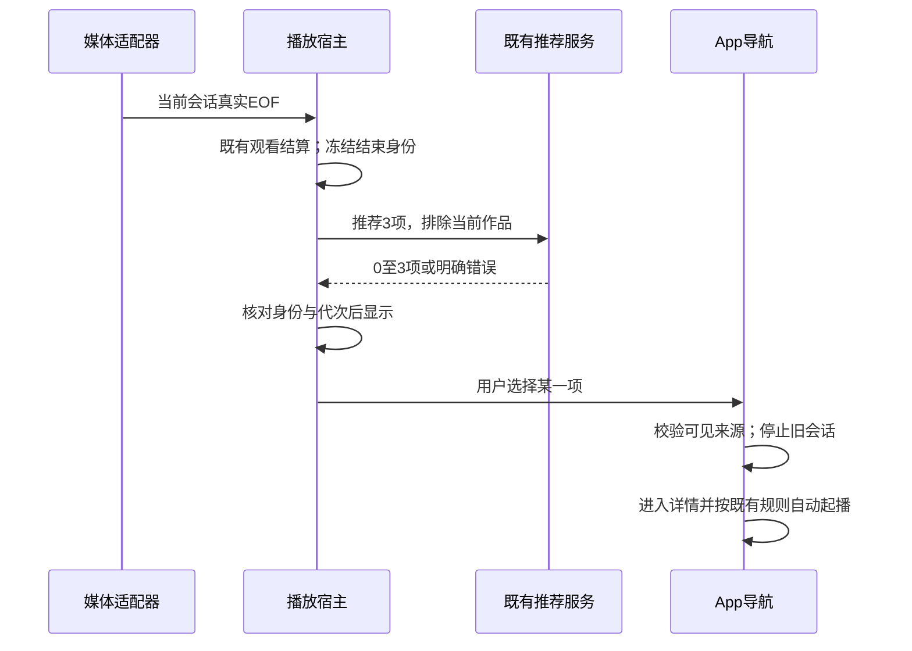
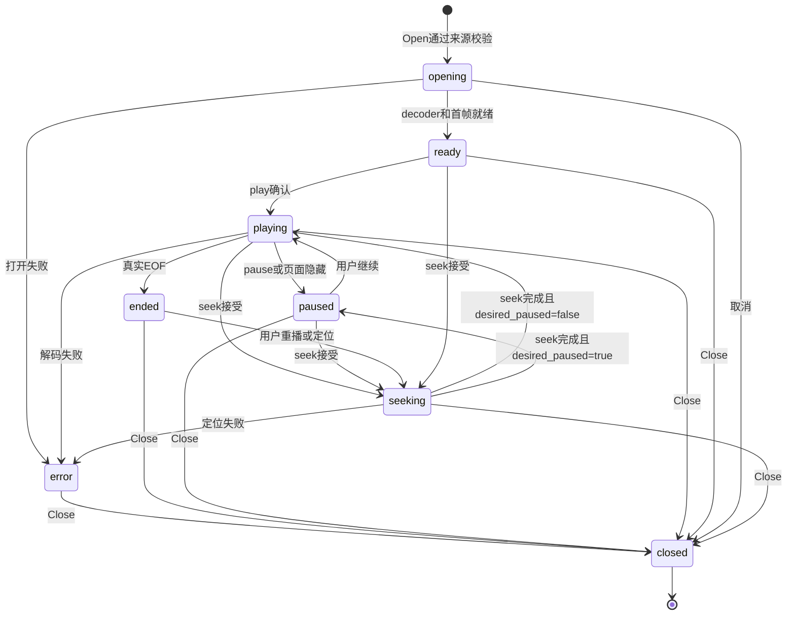

# 动态发现与应用内连续观看 · 详细设计

状态：2026-11-05批准的详细设计，2026-11-06按用户实施授权完成本轮交付。精确验证范围和既有问题以[执行记录](../../plans/2026-11-05-discovery-playback.md)为准，设计参数不是跨平台或所有文件性能保证。

用户追加裁定：新增基础能力不能依赖用户提供AI Token；全部存量和新增视频在空闲时自动补齐。本稿不新增云模型调用、不下载模型、不自动生成语音字幕。原有显式AI功能保留。后续用户明确授权拆分执行计划并实现；本轮未提交、推送、安装或部署。

## 1. 范围与验收目标

| 目标 | 可观察的验收 |
| --- | --- |
| AC-01 更多内容 | 首页默认9张；首页及视频页可进入独立“发现”页面，每批12张。资源不足显示真实数量，不凑重复项 |
| AC-02 有新鲜感且不跳位 | 返回首页轮换3个位置；实际播放开始后单项补位；留在页面时不定时换序，保留滚动锚点。支持主动换一批 |
| AC-03 播完可继续 | 正常单片结束，播放器内部显示最多3张随机推荐及重播；用户选择后进入对应详情自动播放，不自动替用户选 |
| AC-04 旧播放合同 | 队列中间项、区间播放、探索预览各守原语义；有效观看、断点、已看只由原所有者写一次 |
| AC-05 老格式即播 | macOS现有交付平台上，实际AVI/RMVB样本首次播放经短暂缓冲即可见画面/听到声音，不等待完整转码、不修改源文件、不开外部播放窗口 |
| AC-06 操作一致 | 原生路径可拖动、暂停/恢复、调音量、显示已有字幕、进入应用内/系统全屏，播完进入同一结束推荐流程 |
| AC-07 零Token可用 | 没有外部模型配置、没有字幕、没有人工标签/章节时，推荐和播放照常使用；自动准备能产生可定位的基础分段与代表帧 |
| AC-08 全库空闲补齐 | 已有及新视频均被发现；忙时停止启动重任务，运行中的任务在有界检查点暂停，重启从已提交进度继续，不覆盖人工章节 |
| AC-09 数据与资源边界 | 来源变化不发布旧结果；删除/维护/换库先停止持有源的任务；自动结果进入双库迁移与备份验证，临时播放会话不持久化 |

### 1.1 本次交付边界

“基础分段”不等于剧情摘要或“最精彩片段”；不编造片段标题。私人频道、完整自动成片、关联画面漫游仍是已认可的后续方向，本稿定义其数据基础，未悄悄宣称这些产品界面已纳入实现完成范围。老格式原生交付目标沿现有macOS 15+/arm64包；其他平台保留原播放路径并明确原生能力不可用，不宣称其他平台已获得即播支持。

### 1.2 现有能力与复用依据

| Owner / 证据 | 保留或扩展的职责 | 不采用的重复路径 |
| --- | --- | --- |
| [VideoService.SuggestTonight](../../../../services/video_discovery.go)、[随机候选](../../../../services/video_random.go) | 只读、均衡加权、版本作品去重、可见性、偏好、排除 | 不加第二套推荐库/打分服务；注意Tonight上限是12，RandomPick上限50不能混用 |
| [HomePage](../../../../frontend/src/components/viewer/HomePage.vue)、App导航 | 首页锚点、播放后补位、详情返回栈；新增发现页 | 不为推荐曝光写观看事实 |
| [InlineVideoPlayer](../../../../frontend/src/components/player/InlineVideoPlayer.vue)、[QueueInlinePlayer](../../../../frontend/src/components/QueueInlinePlayer.vue) | 播放用途、观看会话、队列报告；新媒体适配器只提供事实 | 不让libmpv直接写数据库 |
| [PreviewService](../../../../services/preview_service.go) | 已有源/代理会话解析；原生分支加性扩展 | 不把AVI/RMVB加进Web MIME白名单冒充浏览器可播 |
| [PlaybackControls](../../../../frontend/src/components/player/PlaybackControls.vue)、[activePlayer](../../../../frontend/src/utils/activePlayer.js) | 统一控制、单活动播放者 | 不各造一套快捷键、观看阈值或全屏状态 |
| MediaProbe / TechnicalBackfill、[ChapterService](../../../../services/chapter_service.go) | 技术快照/原章节，人工章节/AI草稿各归原owner | 自动分析不写manual集合或伪造AI草稿 |
| [SceneIndexService](../../../../services/scene_index_service.go) | 现有图像向量/描述索引维持手动能力 | 其提供方/模型依赖不适合零Token结构补齐，不自动启动它 |
| [单帧缩略图](../../../../services/thumbnail_frame_at.go)、IdleGate、MediaWorkSlot | 复用帧读取、空闲等待、串行重媒体槽 | 不增加新的全局锁、并行转码队列 |
| [播放生命周期](../../../../services/playback_lifecycle.go)、App维护/退出流程 | 先关门、取消并排空，再维护/换库 | 不让新服务在数据库已切换后写旧任务结果 |

本稿新增两个明确owner：`NativePlaybackService`只管理原生播放资源；`VideoStructureService`只管理无模型结构结果和后台补齐。后者的新增理由是：原ChapterService保存人工/经确认的语义内容，SceneIndexService依赖模型，二者都不能兼作自动确定性结构的唯一写者。技术探测、帧读取和任务显示仍复用现有能力。新owner的更改范围与生命周期写在后文，不能散落到页面或App全局字段。

## 2. 推荐批次与首页行为

### D-005 · 会话内曝光与批次更新

业务目标由[概要D-001](概要设计.md#D-001)拥有；这里定义更新和接口。

**数据与状态。** App为本次运行创建一个`DiscoverySession`（前端普通对象），供首页和发现页使用。仅存最近100个展示视频ID的有序去重环；新展示移到末端，重复曝光不增长；换数据库或应用重启清空，不落localStorage、不落库。各页面仍各自持有`items`、查询条件、请求代次和滚动位置。结束推荐独立保存该结束会话的三张卡，不修改首页批次。

只有卡片进入可见区域且页面active时才记入曝光环；网络响应、骨架、预取不算展示。无IntersectionObserver时按本次实际渲染的批次登记，不因此启动额外查询。这里是呈现口径，不影响正式观看统计。

**请求预算。** 使用原`SuggestTonightVideos(request, limit)`，`limit=9/12/3/1`分别用于首页首批、发现批次、返回轮换/结束推荐、播放后补位。原接口`limit=0→6`、最大12保持；不新增第二个后端选片接口。`exclude_ids`原实现只保留末100个，调用方必须先留出本批全部ID与当前视频ID的空间，再补最新曝光ID，最后将必须排除项放在尾部；不能无界拼数组后让服务端随机截掉当前作品。

原抽样器按版本作品处理排除和去重：客户端只提交ID，不复制group规则。区分两类排除：硬排除是本批仍显示项目、当前播放作品、用户暂避/目录/观看/时长条件；软排除仅指本轮自动记录的历史曝光。原服务请求形状不变，调用方分开保存这两类，不能把用户条件一起清掉。

**有限片库的新轮次。** 正常请求排除硬集合+曝光环；成功得到0项时（网络/服务错误不算），说明在本次条件和排除下没有新候选。前端将曝光环清空并递增`round`，仅以硬集合再请求一次，开始新的浏览轮次；每个用户/返回触发最多这两次选片查询，这不是网络重试或条件降级。第二次仍为0则保留当前未失效项目并提示“符合条件的内容都在这里了”。新轮次仍不把当前已显示作品再放进同批。小库可在轮次间重新发现旧作品，不会因所有候选都进入100项曝光环而永久冻结。

| 触发 | 更新规则 |
| --- | --- |
| 首次进入首页 | 申请9项，成功原子展示；失败在本区块显示重试，不影响其他首页区块 |
| 首页inactive→active | 每次只执行一次逻辑轮换（至多两次选片查询）；取轮换游标指向的3个位置，排除整个当前批次和有界曝光。得到k项只替换k个，剩余旧项保留；游标前进3（模当前目标9）。小于9张时优先补缺口，最多请求3项 |
| 同一详情返回 | 同上一次返回只轮换一次；实际播放补位已经发生的卡位不重复并发替换，合并至最新批次代次执行 |
| 当前推荐实际开始播放 | 沿用pendingTonight/playback-started对应关系，每个ID/播放起始token只补位一次；仅打开详情但播放失败不移除。请求1项，没候选则移去已播放卡并显示实际数量 |
| 主动换一批 | 首页请求9、发现请求12，排除当前整批和曝光环；有新结果则整批替换。0项保留旧批次，显示“暂时没有新的候选” |
| 停留、暂停、窗口Resize | 不换批次、不重新抽签 |
| 视频失效、删除或改为不可见 | 从显示批次移除，合并触发缺口补齐；请求失败不把已失效项目放回 |
| 换数据库/条件 | 递增请求代次，清空旧批次与曝光；旧响应丢弃 |

少于3个新候选是正常结果；“轮换3个”是目标数量，不是伪造新内容的保证。曝光淘汰或明确开始新轮次后旧项可以再入选，但本批和用户硬条件始终保留；状态说明新轮次，不把重复发现称为全新入库。只改新首页/发现入口的轮次管理，原TonightPickerDialog的用户条件合同不改。

响应应用需同时核对`pageGeneration`、`requestSeq`和发起时的批次版本；用户离页只取消展示更新，不凭空记录曝光。新页再次激活时发新请求。卡片用video.id作为key，部分换位不改变未换卡的DOM身份；所有批次变化复用HomePage的captureViewAnchor/keepViewAnchor。推荐大图只在新批次提交后按该批次第一项更新；用户在原大图交互期间不自动替换。

**发现页。** 新页面路由键`discover`，首页“发现更多”和视频页“今晚看什么”旁的“进入发现”都能打开。每批12项，沿用现有`TonightPickerDialog`条件含义和计时预算；保留原弹窗，避免改掉随机播放入口。发现页支持换一批、卡片进详情，返回保持条件和本批，不主动再抽；只有首页返回执行轮换。无无限追加DOM，批次替换保持12上限。

## 3. 结束画面与导航

### D-006 · 真实结束事实、三张推荐与一次导航

[概要D-002](概要设计.md#D-002)拥有交互目标。新增共享展示组件`PlaybackEndScreen`，放在播放器surface内部，现有全屏容器无需退出就能显示。推荐卡提供缩略图、标题、时长，支持鼠标/键盘选中；“重播”从0开始新view cycle。显示推荐不自动起播；推荐失败显示“推荐暂时没取到／重试”和重播。请求最多3个，0项仍能重播。读推荐不创建观看、随机播放计数或队列项。

**结束事件。** InlineVideoPlayer加性新增`playback-ended`事件：`{videoID, sourceVersion, viewSessionID, cycle, origin:'inline', reason:'eof'}`。仅收到媒体适配器真实EOF且当前用途是整片播放、不是seek中/close/error时发一次；bookmarkRange停止、browse-preview循环、取消/换源不发。重复EOF以`viewSessionID+cycle`去重。用户拖到末尾但未恢复播放不据此制造EOF；恢复播放后真实读到EOF可以结束。原watch-progress完成报告与有效观看判定先按既有逻辑结算，结束推荐无权修改统计结果。

**宿主范围。** 整页详情和PreviewDrawer宿主共用`usePlaybackEnding`本地逻辑，维护`idle/loading/ready/error/navigating`及请求代次；播放器组件不直接依赖推荐服务或App导航。PreviewDrawer选择推荐时先正常关闭自己的预览会话，再显式请求`open-video-detail`，不沿旧“管理区点击视频仍开抽屉”的默认分流。App接专用意图并调用既有`openVideoResolved/openVideoDetail`，与其他来源共用可见性/文件检查和返回栈。

当前`GetVideosByIDs/GetVideo`并不当然等同于扫描范围核验；结束推荐的点击校验必须复用`bookmarkSourceInScope`同级来源验证能力，不能只执行DB主键查询。设计新增服务内部`ResolveVisibleVideoForPlayback`，供原生打开与该导航校验复用，返回既有视频详情或明确不可用；是否加App入口由已有详情加载链路的实际复用决定，不为纯Go helper生成Wails绑定。

点击推荐沿现有续播规则决定start/resume，`autoplay=true`且初始静音不变。点击重播才明确start=0。双击/连续点不同卡：单次导航generation控制，最新有效选择生效；已开始导航时暂禁卡片，失败恢复，旧请求不能把用户拉回另一详情。导航离开/播放器换源即撤销未消费选择；不可用提示在原结束画面保留，不替用户换另一部。

实施细化（保持已批准的来源约束）：`ResolveVisibleVideoForPlayback`返回的source_version贯穿App详情路由；旧播放器退役后再次验证可见性及相同来源。新的`GetVerifiedPreviewSession(videoID, sourceVersion)`只用于该交接，内嵌资源地址附source_version，每次Range请求在打开前后重新验证来源；普通预览原调用合同保持。队列结束选择由Panel保留结束身份和暂停画面，停止后台队列后不因session变空自行卸载选择组件；失败能继续选择，成功导航才清理保留态。

**队列。** `QueueInlinePlayer`继续只报告原token/seq/viewCycle，不自行推测是否耗尽。后端队列owner在接受最后一条完整视频的结束且决定不再前进后，在`QueueSnapshot`加性返回`ending`：`{token, view_cycle, video_id, source_version, reason:'exhausted'}`；字段可空，只有authoritative耗尽才出现，序列和队列修改共同使它失效。队列分页has_more或Items最后一项不能作为耗尽依据。队列中间项照常前进；片段队列结束不显示整片推荐，保持原结束页。用户选推荐后先成功退役队列播放会话，再走详情导航；退役失败不并行播放新片。

## 4. 老格式原生播放

### D-007 · 路由、所有权和媒体适配

本设计采用libmpv render API路线，见[概要D-003](概要设计.md#D-003)。本机Wails 2.11.0/macOS集成尚未验证；源码与官方接口仅作设计依据，不将单独mpv播放器能播视作应用内集成通过。

`NativePlaybackService`是App组合根创建的单实例资源owner；持有会话表、来源身份和native句柄。`native/playback`的Objective-C/C桥持有libmpv与GPU绘制，**同进程**。不把独立mpv进程窗口当作嵌入，不假设native崩溃可以跨进程隔离：致命解码器/渲染错误可能影响应用进程，需在集成测试中覆盖损坏文件和生命周期压力。

| 请求路径 | 决定 |
| --- | --- |
| 已有有效代理 | 保持原优先命中和来源校验，走原inline；不复制生成新代理 |
| 原文件可由WebKit直放 | 保持原inline路径 |
| 否则，原生能力可用且当前为正式应用内单片/整片队列 | 新mode=`native`，不自动排完整转码 |
| 原生运行时缺失/不兼容 | mode=`native-unavailable`，说明原因，保留用户主动选择外部播放/生成代理按钮；不能将其算作即播验收通过 |
| 原生尝试失败 | 同一播放器报失败，用户可重试或明确选现有替代动作；不静默转码、跳片或开外部窗口 |
| 探索短预览/帧工具、手机HTTP播放、Jellyfin | 保留原合同，不因为native能力擅自改变路径或协议 |

正式宿主新增`GetPlaybackSession(video_id)`作为只读选路入口；原`GetPreviewSession`仍供字幕工作台、比较/探索工具使用，保持Web/代理语义。该拆分来自实施期调用方核对，防止工具错误获得原生会话；选路仍由VideoService原预览模块拥有。

`PreviewSession`加性新增`native_source:{video_id,source_version}`，不含本地路径、句柄、通用mpv选项。旧mode字段和inline_source保持兼容；原生分支只经Wails绑定调用，不开放新的LAN文件访问接口。`GetPlaybackSession`是只读能力选择，不创建decoder；用户实际播放宿主才打开会话。

前端新增`NativeMediaElement`，与HTMLVideoElement都实现同一`PlaybackMedia`契约，放入现有media-controller的media槽，复用PlaybackControls及原观看session。Media Chrome官方允许提供相同媒体API的自定义element，但本仓库锁定4.19.4仍须做实际控件契约测试，不能仅凭文档推定所有属性都兼容。

| 适配契约 | 必须行为 |
| --- | --- |
| `play():Promise<void>` / `pause()` | play在native确认开始后resolve，失败reject；pause保留位置，不伪造EOF |
| `currentTime` / `duration` / `paused` / `ended` / `seeking` / `readyState` | 单位与HTML一致（秒）；native毫秒在唯一边界转换；未知duration为NaN；只根据native事实更新 |
| `volume` / `muted` / `playbackRate` | volume 0..1，mute独立，速率沿现有控件范围；命令失败恢复实际值并提示 |
| `videoWidth` / `videoHeight` / `seekable` / `buffered` | 实际视频尺寸；本地原生不伪装已下载整段，seekable仅在decoder确认后为0..duration，buffered不冒充整片缓存 |
| 标准事件 | loadedmetadata、canplay、play、playing、pause、timeupdate、seeking、seeked、volumechange、ratechange、ended、error，顺序由native事实驱动 |
| 文本轨 | 复用既有SRT解析/选择/显示偏好，通过下文SubtitleRenderer适配交给native文字覆盖层；不假装HTML track会在custom element里自动渲染。逐字稿仍用同一cue投影 |
| DOM行为 | add/removeEventListener、focus、getBoundingClientRect仍由custom element提供；不是裸JS对象冒充DOM |

任何尚未支持的媒体属性必须明确标注并在对应控件禁用，不以假的成功值通过测试。尤其字幕、seek、全屏均为AC-06必需项，不能作为“将来再补”的默认缺口发布。

### D-008 · 画面合成、控件和原生线程

libmpv render API提供OpenGL后端；设计采用AppKit管理的渲染view、专用串行render线程，控制/事件循环与render线程分离。AppKit视图创建/布局/销毁仅在主线程；mpv唤醒/帧回调只投递信号，不在回调内同步调用控制API或等待主线程。render context先于播放创建，停止绘制并清空回调后再释放context，最后释放mpv句柄。

**采用的布局约束。** native view只覆盖画面矩形，控件栏在其外部预留的底部区域，不让原生view挡住HTML按钮。原生视频上需要显示的字幕由同一native绘制层呈现；推荐结束层出现前隐藏native画面，显示HTML卡片。应用内/系统全屏都扩展宿主容器而非创建mpv独立窗口；native矩形随容器重算，控件仍在其外。

浮层/菜单/确认框跨越视频矩形是主要集成风险：设计要求原生合成层能裁剪或暂时隐藏遮挡区域，且不透出到弹窗之上；隐藏画面不允许继续抢输入。不得仅靠DOM的z-index假设能压住NSView。若使用冻结帧填补被遮挡的画面，该帧只保留当前会话内存，不走逐帧base64传输或磁盘截图路径。此处的实际合成机制属于技术验证P0，必须在Wails真实窗口证明；验证失败需修订本节，不能直接实现一个盖住弹窗的版本。

`SetNativePlaybackViewport`接收CSS像素的宿主视口内矩形，native侧读取真实WKWebView尺寸、屏幕backing scale并转换坐标；不能让JS传原生窗口指针。输入需为有限数、非负面积并裁剪到所属WebView。Resize/scroll在requestAnimationFrame合并，每会话最多30次/秒，revision递增；旧revision忽略。零面积或页面不可见立即隐藏并暂停，页面回来保持暂停，用户明确播放；全屏转换期间不销毁decoder。

native渲染画面的单击、双击、指针坐标统一转发给宿主既有播放/全屏手势；不注册第二套全局快捷键。Esc仍由当前最上层模态/全屏owner处理。窗口关闭、切到其他页面、详情重挂、维护时明确Close，不能仅隐藏view后留声音。

**字幕适配的确定合同。** 现有`PlaybackSubtitleControls.project()`会创建Blob VTT、DOM track并设置VTTCue布局，这段只能保留在`WebSubtitleRenderer`中。新增播放器无关`SubtitleRenderer`接口：`setDocument({cues,fingerprint})`、`configure({enabled,offset_ms,preferences})`、`clear()`、`dispose()`；控件仍调用原GetPlaybackSubtitle，逐字稿仍用原projectTranscript，选中backend后交给相应renderer。NativeSubtitleRenderer不注入DOM track，不把整份字幕反复经JS传给native。

Native renderer调用D-009的`ConfigureNativePlaybackSubtitles`，传原服务返回的subtitle_fingerprint；后端使用[已有GetPlaybackSubtitle](../../../../services/subtitle_playback.go)按会话video/source/queue身份重读受控字幕，核对指纹后将cue快照交native层。启停、偏移和字号/背景/位置一起作为一个配置revision提交。native按实际播放时钟计算重叠cue并绘制，不能依赖4Hz timeupdate来决定字幕切换。纯文本转义后渲染，不把字幕当HTML、ASS命令或脚本执行。

设置枚举沿原normalizeSubtitlePreferences：size=`small/medium/large/xlarge`，background=`none/translucent/solid`，position=`bottom/middle/top`；offset_ms限制[-60000,60000]，投影规则与现有subtitleOffsetMS/projectTranscript一致。Web轨道及native投影共享测试夹具，覆盖负偏移、多行/重叠cue、末尾边界、seek后立即更新。若原生层已有内嵌字幕，不在本轮自动选中或与外置SRT同时显示，字幕选择合同保持原有范围。

刷新字幕、换源和clear立即清空已显示字幕，并提升renderer generation；异步解析结果只有session、source、fingerprint和configuration revision都匹配才可提交。配置失败显示字幕错误并清空该字幕层，视频不因此转为解码失败；关闭字幕/卸载将native cue快照释放。回到同一视频要重新获取当前指纹，不复活旧cue。字幕生命周期由renderer负责，不增加第二套观看状态。

**技术验证必须覆盖：** WKWebView与native view定位；Retina/跨屏/滚动裁剪；字幕遮挡；音量和全屏popover；结束卡片；窗口失焦；频繁换片；两个宿主竞争播放；真实Wails打包签名。不升级Wails主版本、不编辑Go module cache；若公共扩展点不足，需记录最小的仓库受控适配改动及其升级维护成本。

### D-009 · 会话API、命令顺序与统计

下面是拟新增Wails契约。参数使用结构体，所有ID的数值范围沿现有JS安全整数校验；会话ID和requestID使用不透明字符串。错误码作为错误文本的稳定前缀，沿现有Wails Promise rejection/translateBackendError映射，不新增HTTP状态语义。生成绑定用仓库规定入口并规范化，不手改生成文件。

| API | 请求与成功响应 | 校验/错误 |
| --- | --- | --- |
| `AcquireNativePlaybackOwner({component_nonce,window_epoch})` | 页面实际准备native播放时申请；nonce为本次挂载UUID。返回`{owner_id,owner_token}`；同nonce且owner存活时幂等 | 后端绑定已登记的主WKWebView和window_epoch，不接受窗口指针/窗口ID。仅Wails应用桥可调用，非LAN路由 |
| `ReleaseNativePlaybackOwner({owner_id,owner_token})` | 先原子撤销能力，再取消pending Open、关闭全部会话，排空后返回 | 幂等；窗口关闭/主WebView重载由native生命周期通知撤销其全部owner，无需依赖Vue钩子 |
| `GetNativePlaybackCapability()` | 无参数；`{available, runtime_version, platform, reason_code, reason_message}`供原生说明与运行诊断 | 只探测已打包库，不初始化播放、不安装依赖 |
| `OpenNativePlayback(req)` | `{request_id,owner_id,owner_token,video_id,source_version,start_ms,paused,muted,volume,queue_token?}`；返回`{session_id,video_id,source_version,state:'opening',seq:0}` | start_ms默认0，非负且不超已知片长；volume默认1范围0..1，muted默认true；重新核验可见性、真实普通文件和来源指纹；非空queue_token还须匹配当前整片队列video/source身份，用于后续受控字幕读取。相同owner/request及相同摘要重入返回同一会话，不重复打开；同键异参`native_request_conflict` |
| `CommandNativePlayback(req)` | `{owner_id,owner_token,session_id,seq,kind,value?}`；响应`{accepted_seq}` | kind=`play/pause`时value省略；`seek`为非负整数毫秒，未知时长/不可seek拒绝；`set_volume`为0..1有限数、`set_muted`为bool、`set_rate`为0.25..4有限数（初始1，非新增速度UI）；seq严格递增，同序同参可重放确认，同序异参冲突，旧序`native_stale_command`。accepted不表示已完成，完成看事实事件 |
| `SetNativePlaybackViewport(req)` | `{owner_id,owner_token,session_id,revision,x,y,width,height,visible,occluded}`；返回`{applied_revision}` | D-008有限数/所属窗口/裁剪规则；不能替另一owner操作view；occluded仅隐藏原生画面以让HTML浮层可见，visible=false或零面积才暂停 |
| `CloseNativePlayback(req)` | `{owner_id,owner_token,session_id,reason}`；reason=`navigate/replaced/hidden/maintenance/shutdown/user`，完成释放后返回 | 幂等：已关闭会话成功；清空回调/音频/view前不宣称关闭完成 |
| `GetNativePlaybackSnapshot({owner_id,owner_token,session_id})` | 返回当前完整状态及seq，用于组件挂接和事件序列恢复 | 未知会话`native_session_closed`；不自动重建 |
| `ConfigureNativePlaybackSubtitles(req)` | `{owner_id,owner_token,session_id,revision,subtitle_fingerprint,enabled,offset_ms,preferences}`；返回`{applied_revision,status:'ready'\|'absent',subtitle_fingerprint}` | 指纹必须与当前受控SRT匹配；enabled=false无需读文件，立即清空；更新仅接受更高revision，同序同参幂等；旧序拒绝。指纹变化返回`subtitle_conflict`并清空旧字幕，不偷偷采用新内容 |

**owner能力的完整生命周期。** owner_id为不透明ID，owner_token为后端生成的至少128位随机能力，仅前端内存持有、不进日志或存储。component_nonce只是幂等标识，不承担授权。Acquire将owner绑定App创建时登记的主WKWebView及其window_epoch，不能用当前keyWindow临时猜测目标（弹窗可能成为keyWindow）。每个命令/字幕/viewport/snapshot均核对owner能力、窗口epoch、会话归属；未知或撤销返回`native_owner_revoked`。可见媒体核验仍必需，owner能力不会扩大扫描目录权限。

同一owner最多1个会话，应用最多2个native会话（当前与交接准备态）；最多4个存活owner，只在可见native宿主实际准备时Acquire，超限明确拒绝。Open先在owner内登记request_id和参数摘要为pending，再做来源IO，返回前再次核对owner未撤销及window_epoch。Release先关门，等待/取消pending创建；解码器刚创建却遇撤销时立即关闭，不能返回可播放句柄。Vue卸载显式Release；Open回复若在卸载后才到，前端不挂接，并幂等Release。主WebView整页导航/重载开始与NSWindow关闭的native生命周期通知强制撤销该窗口所有owner；这一钩子的Wails接入属于P0，不能假设Wails自动知道Vue页生命周期。

会话表仅当前进程有效。owner撤销后先令token不可用，待所有pending和资源排空才删除记录；后续未知owner的Release为幂等无操作，但其他命令均拒绝。窗口epoch在重载/维护时递增，旧token永不重新有效。前端不能跨owner操作会话，即使知道session_id。

播放事实通过Wails事件`native-playback-state`：`{session_id,seq,video_id,source_version,state,position_ms,duration_ms?,video_width?,video_height?,paused,muted,volume,rate,error_code?,error_message?}`。state=`opening/ready/playing/paused/seeking/ended/error/closed`。position按播放中最多4次/秒推送，状态变化立即推送；seq由native owner生成，与命令seq分开命名/存储，响应`accepted_seq`不能冒充状态序列。客户端只接受当前session且seq更大的事件。事件丢失时显式读snapshot，不重播命令、不写猜测位置。

会话维护desired_paused；seek期间play/pause只更新该期望，等seek完成后再报告实际playing/paused，不伪造已经开始。`ended`不销毁会话，重播先seek0，再由原观看owner开启新viewCycle；error不自动重新Open。任何非terminal状态都接受Close，未列出的非法状态命令返回`native_invalid_state`。旧source/session的EOF不可写新视频的已看。

**统计归属。** NativeMediaElement不调用RecordViewEvent或UpdateVideoWatchProgress。InlineVideoPlayer复用当前viewSession/accumulator、起播origin和10秒节流，媒体适配器只替换事实源。队列走原`ReportInlineQueuePlayback`的token/seq/view_cycle；QueueSession加性引入`media_mode:'inline'|'native'`和native来源描述，旧locator/mime在inline不变。两个队列都不能由NativePlaybackService自行推进。

现有activePlayer会在新play时暂停旧媒体；原生Play确认前必须等待旧native暂停确认，避免异步命令导致双音轨。跨Web/native切换由前端交接逻辑等待`pauseAndReportProgress`及native暂停事实；其中任一失败则不开始新声源。App的播放维护流程先阻止新Open，关闭所有native并排空，再进入原数据库维护围栏；关闭未完成时维护失败保留旧数据库，不切库。原生文件句柄必须在原片移动/永久删除前由源协调能力关闭。

### D-013 · 打包、失败边界与即播验收

原生依赖从固定版本源码/校验清单构建并随应用打包，候选基线为mpv 0.41.0及固定依赖版本；最终构建清单在P0中固定。不得依赖用户安装Homebrew mpv或读取用户mpv配置。禁用用户配置、脚本、插件自动加载和网络来源；只接受后端解析的本地已授权文件，前端不能传URL、命令字符串、ffmpeg/mpv选项、字幕路径或native handle。已有字幕由服务端核验后提供内容/受控文件，外部字幕资源不能自行触发联网。

沿用已有本机签名脚本：资源装配后签名、核验所有dylib依赖闭包与最低系统版本，再签主包；失败阻止安装。记录来源、版本和许可证材料，不凭文档断言某种分发许可已被验证。开发和发布的来源匹配检查相同，不因为安装路径不同而跳过。

| 失败码 | 用户看到的结果 |
| --- | --- |
| `native_unavailable` / `native_runtime_mismatch` | 本机播放组件不可用，停止native创建；明确的手动外部播放/代理动作仍在 |
| `source_unavailable` / `source_changed` | 文件离线/不在范围或已变化；不沿旧来源播放，重新打开当前记录才能重取 |
| `native_decode_failed` / `native_seek_failed` | 当前会话停留并解释失败，不自动跳片或转码 |
| `native_request_conflict` / `native_stale_command` / `native_invalid_state` / `native_owner_revoked` | 调用方重新读取当前状态或取消旧意图，不隐藏为成功 |
| `playback_quiesced` / `native_session_closed` | 禁止新播放或已退休，旧事件忽略 |

性能验证目标（设计目标，非既有测量）：在当前支持的Apple Silicon/macOS、内置SSD、无其他重任务条件下，代表性≤1080p AVI/RMVB样本冷启动首帧P95≤3秒、暖启动≤1秒，随机seek首帧P95≤2秒；每组至少20次，记录编码、分辨率、时长、音轨、机器及版本。慢盘/损坏文件单独报告，不从样本中删除后宣称所有文件达标。若样本无法达到目标，需要优化或明确修订，不改为完整转码后播放。上述目标为便于核验“短暂缓冲”选取的工程基线，正式发布前用真实样本结果确认适用范围。

## 5. 无Token内容补齐

### D-010 · 自动结果的含义与算法

范围沿[概要D-004](概要设计.md#D-004)：全部可见存量和新增视频。当前不启动SceneIndexService向量/外部描述，不调用TextAI，不自动ASR，不要求配置Token，也不弹出要求用户先补章节的阻塞页。

`VideoStructureService`执行本机确定性分析，复用MediaProbe读取容器章节，复用本机FFmpeg定位/抽帧能力；新增结构算法只处理时间、变化分数和代表帧位置，不保存完整音视频副本。输入是后端确认的video/source_version；输出`automatic`集合，与`manual`/`embedded`分开。

| 优先级 | 内容展示 |
| --- | --- |
| 有用户保存的manual集合 | 默认显示manual；自动结果仍可在独立页签查看，不覆盖 |
| 无manual且embedded有效 | 默认显示文件自带章节，保留原标题/跨度 |
| 二者无有效结果 | 展示自动分段：通用标题“片段01 · 00:00”，代表帧和起止时间 |
| 尚在准备/能力缺失 | 视频照常播放，显示准备状态；首页和结束推荐不依赖这里 |

自动基础参数以`algorithm_version=local_structure_v1`固定，变更参数须换版本，不用同版本覆盖旧语义：按不高于2fps的分析采样与缩小灰度图计算相邻画面差异，候选变化阈值0.30；有效最短段5秒、最长目标180秒。长时间无明显变化也按目标时间切分，标`basis=interval`，不称作镜头检测命中。有效容器章节附近的采样边界标`basis=embedded`，只保留边界依据，不继承或编造标题。阈值/最短最长是实现默认，需用单镜头、渐变、闪光、黑屏和VFR夹具验证；不宣称固定阈值能识别剧情。

按源时间120秒窗口处理，边界使用真实PTS，保留上一窗口末采样和未闭合段起点作为检查点，避免每个窗口凭空制造章节。候选靠近容器章节时以有效容器时间为参考，但不改文件章节。全片最多500个公开自动段；超过时按相邻差异最小优先合并，确定性并列以起点小者优先，来源边界记录仍可诊断。最终无重叠、无负时间、覆盖0..duration（尾端用实际探测时长）；短于5秒的视频得到一个完整段。损坏/未知时长不能伪造duration。

每段从20%/50%/80%三个时点选择代表帧，先排除近全黑，再按本机清晰度指标选择，仍全部不佳时使用中点并标记；位置是真实PTS且必须在段内。不把该分数称作精彩度。已有SRT可供用户点开该段时显示对应对白摘录，复用原字幕索引和时移规则；自动结构不生成语义摘要，不另存一份字幕正文。

代表帧通过既有受控单帧路由/缓存读取；结构库只存`representative_ms`，不新增几百份永久封面文件。发现列表仍取原视频缩略图，不因首页请求触发整片分析。跨片探索后续可以消费此结果，但不能修改本服务的生成状态。

### D-011 · 派生存储、检查点与发布

新增两张派生表，独立于人工ChapterSet；SQLite/PostgreSQL双腿一致。视频永久删除级联清理，软删除/隐藏不对用户展示也不继续处理；文件离线保留已发布结果但标不可定位。

| 表/字段 | 约束与用途 |
| --- | --- |
| `video_structure_states.id, video_id` | 主键；video_id唯一并引用videos，删除级联。每视频只有一个状态owner |
| `source_size, source_mtime_ns, source_version` | 本次分析来源；格式沿现有来源指纹。不是内容hash，不宣称能识别同大小同mtime恶意替换 |
| `algorithm_version, revision, generation` | 算法版本；revision单调CAS版本；generation每次重新分析递增，防止A→B→A误认旧run |
| `phase` / 段的`representative_ready` | 私有实现检查点：analyze完成后进入representatives，每次仅选一个段的代表位置；该阶段中断仍能逐段继续，不公开半成品 |
| `status` | `pending/running/waiting_idle/ready/failed/source_changed/unavailable`；暂停/重启不会当作完成 |
| `checkpoint_ms, pending_start_ms, previous_sample_pts, previous_sample` | 前三项为int64毫秒；previous_sample为≤5184字节的96×54灰度采样（Go []byte，SQLite BLOB/PG bytea），只存上一窗口末帧缩小样本，不存原图/字幕。字段一起提交，恢复不能跳过未提交窗口 |
| `published_generation, published_source_version, published_algorithm_version` | 可空；只指向完整公开结果。与当前分析字段分开，重新分析不把旧结果标成新来源 |
| `run_token, error_code, updated_at` | UUID运行身份，不跨启动复用；短错误码与清理后的诊断，禁止记录文件绝对路径/字幕文本 |
| `video_structure_segments.id,state_id,generation,position` | state_id外键级联；唯一(state_id,generation,position)；staging与published由generation区分 |
| `start_ms,end_ms,representative_ms,basis,score` | 毫秒边界，basis=`change/interval`；score仅内部排序/诊断，不向用户称内容质量。CHECK start≥0,end>start，代表位置在范围内 |

所有generation/revision/position为非负int64，跨JS暴露时受安全整数上限约束；时间字段为int64毫秒，score为有限double（内部使用）。按`(status, updated_at, id)`索引获取待处理；恢复/新文件事件以video_id唯一键去重。段按(state_id,generation,position)读取。禁止把完整候选/字幕/图像塞进无限JSON字段。

单worker是正常写入owner，但正确性仍依赖显式条件更新：认领时`WHERE id=? AND revision=? AND status IN ('pending')`设置running、run_token并revision+1，影响0行重新读后跳过，不执行已失去所有权的外部处理。每窗口在事务内写staging段并更新checkpoint，谓词必须包含run_token+generation+revision+source_version；0行则窗口写入一起回滚。禁止SELECT FOR UPDATE或应用数据库锁，也不在数据库事务里运行FFmpeg。

完成后重核验来源、算法、可见性和run_token；事务中合并段、验证数量与全片范围，再CAS更新published字段和ready状态，同时删除旧generation/staging。读者只看published_generation，不读取部分窗口。扫描发现来源变化时递增generation/revision使旧worker不能提交；旧published保留但source_status=changed且禁止定位。不得因旧字段仍有值就把它显示为当前有效结果。

**状态转换与恢复。** 状态唯一写者是VideoStructureService，扫描/能力事件只向owner发标记请求，不直接并行更新结构表。所有下表写入都以当前revision CAS；除单纯门控转换外，失效或重试必须清除run_token并提升revision。state的active generation和published generation分开，表中“重开”只影响active。

| 当前状态／触发 | 原子结果与后续 |
| --- | --- |
| 无记录／发现可见视频 | 插入pending，generation=1，checkpoint=0；唯一冲突读已有行，不重复建任务 |
| pending／门未通过 | waiting_idle，保存pause_reason，run_token置空；不占工作槽 |
| waiting_idle／门重新通过且开启 | CAS到pending，再由worker认领；不直接沿用旧run_token |
| pending／worker认领 | CAS到running，分配新run_token，revision+1；有效checkpoint和generation保留 |
| running／一个窗口成功 | 同事务写staging和checkpoint、previous_sample、pending_start_ms；revision+1并置pending、清run_token，释放窗口槽后参与公平调度；下一窗口重新认领 |
| running／忙、播放开始、用户暂停或关开关 | 先取消并等待子进程退出，再CAS到waiting_idle、run_token清空，已提交checkpoint保留；未提交窗口不写入。pause_reason区分user_active/active_playback/disabled/on_battery/outside_window/probe_failed |
| running／全片发布成功 | 事务更新published_generation等并ready、run_token清空；未通过来源复核则不发布 |
| pending/running/waiting_idle/ready/failed／发现来源或算法变化 | generation+1、revision+1、active checkpoint与末采样清空、run_token撤销、status=source_changed，保留旧published；取消旧worker。重新核验后进入pending，旧generation staging清理 |
| 任意可处理状态／文件离线或缺必要本机依赖 | unavailable，记录reason，撤销run_token；来源相同则保留checkpoint，否则重开。已有published只读展示且不可定位 |
| unavailable／扫描确认文件恢复或依赖能力检查由缺失变可用 | 重新核验source/算法，相同回pending保留checkpoint，变化按source_changed重开；检查在启动、扫描和用户刷新依赖状态时触发 |
| running／真实处理错误 | failed，run_token清空，保留已提交checkpoint和旧published；同输入不自动反复跑 |
| failed／用户显式重试 | 重新核验后CAS到pending；来源/算法同则保留已提交窗口，依赖能力变化可由owner发同一重试意图；不在事务中重试外部工作 |
| 任意／永久删除 | 原视频删除事务级联state/segments；旧worker写0行后取消，不能重建记录。软删除/移出范围先取消并置unavailable，不公开结果 |

启动恢复先在门关闭时扫描全部非终态：running、waiting_idle和pending统一撤销旧run_token、revision+1，来源/算法一致时保留checkpoint，状态为pending；source_changed则清理旧active staging并以0检查点进入pending。随后再过空闲门，因此pending不意味着立刻运行。ready仍需检查来源/算法；failed保持failed（除非输入/依赖已变），unavailable只在恢复信号出现后重核验，不能因重启就对离线盘反复执行分析。disabled设置持久化时恢复后仍留waiting_idle。任何状态都不能在旧token下继续提交。

检查点“上一采样”只用于跨窗口边界计算；每窗口最多240个分析帧，候选按游标落库。最终段合并使用有界候选堆/有序游标，不把超长视频全部候选加载到内存。长视频使180秒目标与500段上限无法同时成立时，上限优先、最小目标长度提高至ceil(duration/500)，basis仍真实记录，UI不承诺每段恰好180秒。

`GetVideoChapterSets`加性提供`automatic`投影（可空）：`{generation,source_version,source_status,algorithm_version,segments:[{position,start_ms,end_ms,representative_ms,title,basis}]}`；原manual/embedded字段不改，不把automatic伪装成可直接编辑的manual。定位新增/复用有来源版本与generation的解析入口，返回当前确认的video和start_ms；若来源不一致明确changed，不用新指纹为旧位置背书。将自动结果转成可编辑章节必须用户显式“复制为人工章节”，沿既有SaveVideoChapters的revision CAS处理；不静默覆盖已有manual。

迁移先建state再建segments，AllModels遵循FK拓扑。双库往返、备份恢复每张新表均有实际行，覆盖ready+pending检查点和旧published/新staging并存状态。恢复后停止态重建run_token，不恢复正在播放的native会话。回滚到旧二进制不自动删派生表；不承诺旧版本备份会包含新表。

### D-012 · 全库发现、空闲调度与退出

新设置`auto_structure_enabled`默认true（新装和升级均纳入已确认的自动补齐方向），同时有暂停/关闭入口。沿仓库布尔默认合同由迁移显式填值，不用GORM default:true把用户false覆盖。`auto_structure_backfill_done`不是独立真相：完成量必须由当前源/算法匹配的状态统计，不能用一个全局布尔掩盖新增或变化。

启动、扫描提交、来源变化分别触发增量发现。用video_id游标每批200行扫描可见视频，仅写缺状态/旧源/旧算法的pending；查询在原维护门内短事务，阶段间释放，不一次加载全库。用户确认的全库包括可见存量；被排除目录、回收站、失效源不入处理队列。首次启用/迁移时在设置中一次性保存`auto_structure_initial_cutoff_id=max(videos.id)`（空库为0），后续启动不改；ID≤cutoff为初始存量，其余为新增，备份/迁移保留cutoff。按“窗口”而非整部长片调度：每处理3个新增窗口至少处理1个存量窗口，每次启动先选1个存量窗口；各类按最后处理时间、ID排序，避免长片占住队首。没有一类则处理另一类；依赖恢复/来源变化保持其ID分类。

任务登记键`video_structure`，沿BackgroundTaskRegistry/任务中心/IdleGate展示waiting_idle及原因，不新造任务中心。worker并发1，每次处理窗口先过IdleGate和原MediaWorkSlot，FFmpeg限制线程2；等待空闲时不占工作槽。用户活动变化后停止启动新窗口，正在运行窗口在5秒内取消子进程并放弃未提交窗口、释放工作槽，已提交检查点保留。既有IdleGate只在项间等待且探测缓存30秒，不能直接用它承诺5秒抢占。设计新增仅对正在运行窗口启用的activity monitor：复用IdleProbe实现但使用独立`maxAge=1秒`快照，每秒检查，单次探测deadline=1秒；探测失败立即按不空闲取消。前台窗口输入/播放开始信号立即触发相同取消；输入事件是加速路径，其他应用里的用户活动仍由新鲜系统探测兜住。检测最长约2秒，子进程组取消/回收预算3秒，共5秒；未退出则保留资源占用并报停止失败，绝不先释放slot假装停止。其他已有任务仍用30秒缓存，不改变其合同。

新能力须始终满足空闲要求：即使用户把原全局自动任务门关闭，本服务也不能因此在前台抢资源；需明确设置提示“自动分段仅空闲运行”，调用同一探测接口但强制本能力启用idle门。非macOS现有探测恒空闲的行为不能作为本能力实际空闲证据；未有可靠探测的平台自动补齐暂停并说明能力限制，手动启动仍按显式操作的资源预算执行。当前macOS为验收平台。

应用内开始播放时，经App播放活动信号立即暂停自动结构窗口；不只依赖鼠标键盘空闲，因为用户看电影时通常没有输入。原生/Web/队列都更新同一播放活动投影；手机服务现有“看过”上报不等于实时播放状态，不能拿它推断暂停。结构任务在手机媒体HTTP传输活跃时暂停，传输结束后再保持30秒安静窗口；该窗口只限制后台资源，不新增观看事实。不将“前端无鼠标输入”视为视频观看已结束。这里保护正在观看的体验，不修改观看统计。

维护/换库/退出顺序：本服务先关门→取消发现及当前FFmpeg→等待worker退出并放弃未提交结果→进入既有数据库维护围栏。原任务已checkpoint部分可继续；取消后的晚到进程输出不能发布。字幕生成、AI打标、场景向量任务开关保持原义，不因auto_structure启用连带运行。

## 6. 来源与核对依据

以下为技术事实来源，不是本项目已完成验证的证明：

- [libmpv v0.41.0 render API](https://raw.githubusercontent.com/mpv-player/mpv/v0.41.0/include/mpv/render.h)：支持的render后端和回调/线程限制；本稿选择render API而非独立窗口嵌入，实际Wails合成待验证。
- [官方嵌入示例](https://github.com/mpv-player/mpv-examples/blob/master/libmpv/README.md)：嵌入方法和平台风险。
- [Media Chrome自定义媒体契约](https://www.media-chrome.org/docs/en/get-started#compatible-media-elements)：可由兼容媒体API的element驱动控件；仍需用仓库4.19.4验证。
- [Wails 2.11.0 window.go](https://github.com/wailsapp/wails/blob/v2.11.0/v2/internal/frontend/desktop/darwin/window.go)、[WailsWebView](https://github.com/wailsapp/wails/blob/v2.11.0/v2/internal/frontend/desktop/darwin/WailsWebView.m)：确认本项目版本而非套用Wails 3接口。
- [FFmpeg HLS格式](https://ffmpeg.org/ffmpeg-formats.html)：保留为技术比较证据，本稿未同时设计第二套分段流生产路径。

Support lenses：架构边界（新资源owner与派生owner）、数据库并发（run_token/generation/revision CAS）、安全边界（后端解析本地来源而非传任意路径）；没有因此增加通用重试、降级平台或监控工程。

## 7. 验证、设计检查与交接

### D-014 · 验证矩阵

| 用例 | 覆盖 | 预期与所需证据 |
| --- | --- | --- |
| T-01 空库/1/2/3/9/12/超过12个候选 | AC-01/02 | 数量真实，无重复；3/9/12上限和候选耗尽语义组件+服务测试 |
| T-02 反复返回首页、停留滚动、连续换批及30/100候选完整多轮 | AC-02 | 返回目标轮换3位，停留不跳位；软曝光耗尽后新轮次仍保持硬条件，不冻结；hero/卡片锚点和有界曝光测试 |
| T-03 请求中换库/条件/离页，旧响应晚到 | AC-02/09 | 不回填、无虚假曝光；当前ID始终在100排除预算内 |
| T-04 正常EOF、重复EOF、重播、拖到尾部 | AC-03/04 | 每cycle最多一次结束层；不把seek/取消当正常EOF，重播新cycle |
| T-05 结束层点击、双击、文件失效、导航被拒绝 | AC-03/04 | 单次正确详情自动播放或原处明确错误；不提前记观看 |
| T-06 队列中间/最后/分页尾/片段尾 | AC-04 | 只有服务端完整视频耗尽事实出结束推荐，原顺序与片段边界不变 |
| T-07 AVI实际编码样本、真实RV30/RV40 RMVB | AC-05 | 实际首帧/音频/seek；不以改后缀文件代替。记录样本来源/参数/hash，禁止读取未授权用户媒体 |
| T-08 native字幕/逐字稿/刷新时移/音量/快捷键/两种全屏 | AC-06 | 与原控件合同一致，浮层不被挡、返回不丢状态；真实Wails而非纯JS模拟 |
| T-09 20次换片/双宿主/owner撤销与Open竞态/来源变/重载/维护 | AC-04/06/09 | 单声源、句柄和view释放、无旧事件污染、维护未排空不切库 |
| T-10 首帧与seek基线 | AC-05 | D-013样本分层P95；无完整预转码缓存的冷启动 |
| T-11 无Token/无字幕/无章节/单镜头/短片/VFR | AC-07 | 可用基础分段、真实时间、不伪造摘要、无外部请求和模型下载 |
| T-12 存量与持续新增、鼠标恢复活动、正在播放 | AC-08 | 存量不饿死且重启分类不变；刚生成30秒idle缓存后立刻输入仍在5秒内取消/释放；空闲再继续 |
| T-13 处理中源替换A→B→A、同任务重复认领 | AC-09 | generation与run_token使旧事务0行回滚，人工章节不受影响 |
| T-14 处理中进程退出、DB切换、永久删除 | AC-08/09 | running/waiting_idle/source_changed均有恢复出口，禁用后不偷偷运行；无旧库晚到写；级联与软删除语义正确 |
| T-15 SQLite↔PostgreSQL、备份恢复 | AC-09 | 两张新表非空往返，ready和staging分离保持、FK顺序正确 |
| T-16 无原生运行时、缺FFmpeg、损坏文件、磁盘离线 | AC-05/07/09 | 明确能力/失败状态；推荐可用，不自动下载/改源/无限重试 |

本轮执行的是源码/协议核对与文档推演，以上实现测试均待实施。语义推演覆盖：候选仅2项时返回2而不是重复凑3；轮换只收到1项则替换1位置；队列has_more不等于耗尽；旧native EOF不能作用于新详情；自动任务在第2窗口取消时只恢复第1窗口checkpoint；来源A→B→A通过generation区分；有manual时automatic发布不写manual表。

### Design Contract Index

| 决定 | 唯一维护位置 | 覆盖 |
| --- | --- | --- |
| D-001/002/003/004 | [推荐目标](概要设计.md#D-001)、[结束体验](概要设计.md#D-002)、[即播目标](概要设计.md#D-003)、[自动准备](概要设计.md#D-004) | 用户认可方向与追加裁定 |
| D-005 | [曝光和刷新](#D-005) | AC-01/02 |
| D-006 | [结束与导航](#D-006) | AC-03/04 |
| D-007/008/009 | [路由与适配](#D-007)、[原生渲染](#D-008)、[会话协议](#D-009) | AC-04/05/06/09 |
| D-010/011/012 | [本机算法](#D-010)、[存储](#D-011)、[调度](#D-012) | AC-07/08/09 |
| D-013/014 | [打包与即播验收](#D-013)、[验证矩阵](#D-014) | 运行边界及全部AC |

### 交接状态

- 已固定：9/12/3的展示规模、会话内曝光、用户选择后自动起播、队列与区间保护、无Token本机基础补齐、全库存量+新增空闲处理、人工内容不覆盖、老格式不等待整片转换。
- 当前采用的技术设计：libmpv render API+现有控件适配；新原生资源owner与结构数据owner；两张派生表和有界checkpoint。它们尚不是已实现能力。
- 唯一实质技术前置风险：D-008原生画面与Wails/Web控件/弹窗/字幕的合成必须实测通过；此风险只限制原生播放器接入，不阻塞首页、结束推荐和结构补齐的独立实现。不能用“外部窗口能播”结案。
- 仍需通过实现验证确定的工程参数：固定native依赖闭包与构建版本清单、代表性RMVB样本可用性/性能基线、变化阈值质量。本稿已给参数与验证方法，参数调整必须版本化并保留事实。
- 已检查仓库相对链接与D锚点，图做语义检查；本机无Mermaid CLI/Graphviz，未声称图已渲染。独立审查记录见下一节。

### 独立审查记录

2026-11-05，只读叶代理`/root/review_discovery_design`审阅概要、详细设计及相关实现，初审提出5项Important、未提出Critical。已逐项修订：D-005区分硬排除/软曝光并定义完整新轮次；D-008/009定义SubtitleRenderer与native字幕配置；D-012增加1秒新鲜活动探测和最坏相位用例；D-009定义owner颁发、撤销、窗口epoch及pending Open竞态；D-011增加完整恢复/状态表。另统一首帧目标表述、固定新旧分类cutoff。同日定向复核确认5项Important均已解决，修订范围无剩余Critical/Important；两项Markdown/措辞小修正已完成。该复核未运行实现测试，不代表P0原生集成验证通过。

实施细化（P-006，2026-11-05）：播放器继续由原前端/队列owner记账。原生后端打开并持有已验证的普通文件描述符，通过libmpv的fd协议借用，Close后才释放；前端仍只收到video/source身份。字幕回传增加不透明`subtitle_token`（由完整后端指纹计算），避免JavaScript不能精确往返纳秒int64；原有字幕指纹对象保持兼容。正式GetPlaybackSession与工具GetPreviewSession分离，viewport的occluded只处理浮层遮挡，页面visible/零面积才暂停。这些细化不增加模型、外发或统计写入owner。

原生宿主握手细化：GetNativePlaybackCapability加性返回window_epoch/window_ready。Acquire必须提交该已就绪document的epoch，后端与当前登记值比较；重载前排队的Acquire不能在新document就绪后获得新epoch的能力。未就绪的当前页面等待native-playback-ready事件；不在后端把旧Acquire挂起到下一document。
