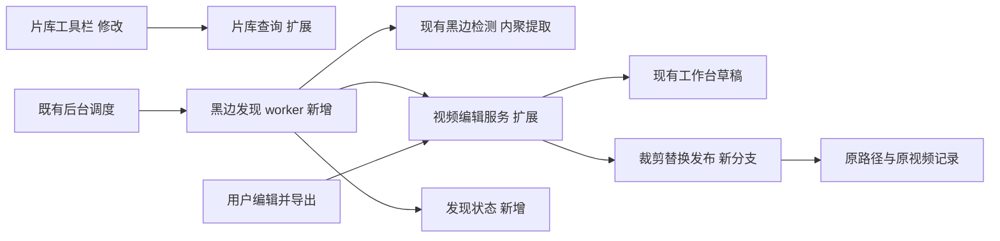
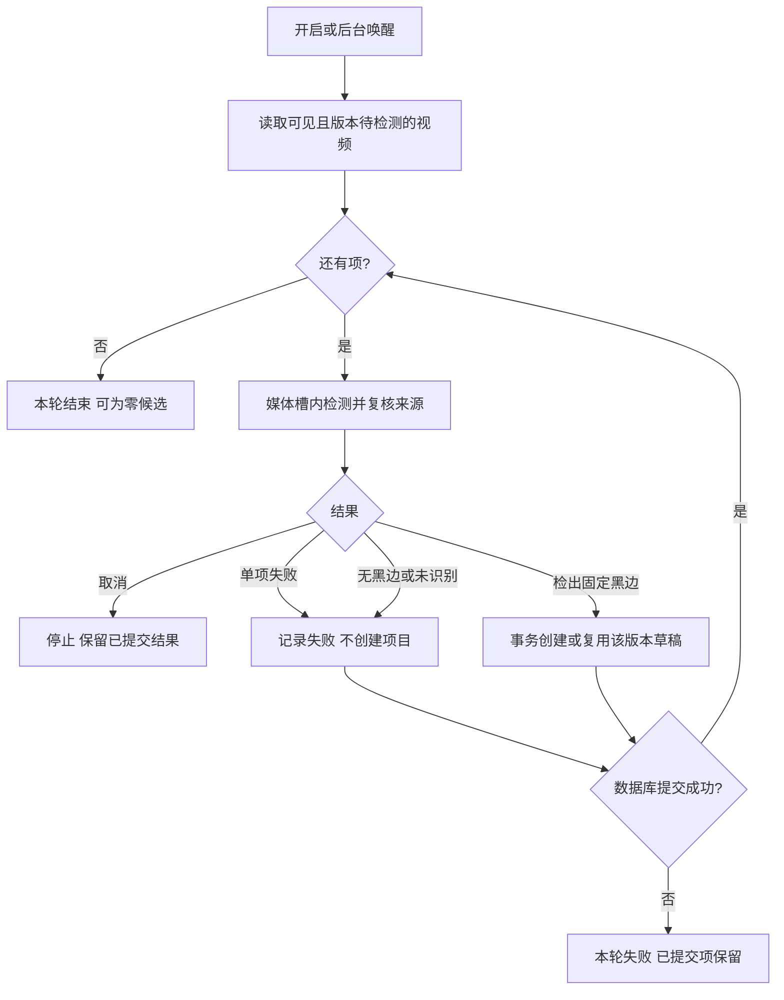

# 片库筛选、排序与自动黑边发现 · 概要设计

状态：v1，用户于设计交付后调用 `$exec` 授权按本方案实施；执行状态见[计划](../../plans/2026-11-11-library-crop-automation.md)。
来源：[原始需求及验收](../../../../.loopx/intake/2026-11-11-library-crop-automation/requirements.md)。
详细合同：[需求设计文档](需求设计文档.md)。修订：2026-11-11 首稿。

## 方案与范围

片库工具栏增加独立的“目录包含”“文件名包含”条件，按 AND 组合；排序增加文件名称和文件大小的升降序。沿用当前服务端筛选与键集分页，避免只排序已加载的页面。普通关键词继续按原规则搜索标题、文件名和路径。

自动识别是后台发现任务：开启后检查全库，并持续处理新增或源文件变更。只把检测出固定黑边的视频加入工作台草稿，用户仍可查看、调框，再明确导出。检测不调用导出队列。

整片裁剪导出完成后替换原路径文件并保留片库记录 ID；选定时间段的裁剪继续另存。原有合并、去片头、高清替换的另存、清理原片和版本组流程保持原合同。整片替换不提供永久原片备份；恢复用临时旧副本只保留到提交收尾完成。

**D-LCA-01 · Behavior Contract · Accepted for implementation**（来源 AC-01/02）：采用独立字段组合筛选及服务端文件排序；边界、默认值与游标见[查询合同](需求设计文档.md#query)。下游验证空条件、交集、双库分页与旧排序，不将文件名称等同显示片名。

## 所有权和核心流程

下图为新增/修改关系；箭头表示调用或写入。现有编辑服务仍是工作台项目及文件发布的唯一所有者，新任务只负责检测进度和发现记录。

**D-LCA-02 · Operational / Workflow Contract · Accepted for implementation**（来源 AC-03）：复用后台任务登记、空闲门、共享媒体槽、维护围栏和取消机制；新 key `crop_detection`，设置 `auto_crop_detection` 默认关闭。开启执行全库待检测项，启动及片库变更后唤醒同一 worker，周期对账弥补漏通知。发现、项目创建在同一数据库事务提交，以源版本去重；不修改人工草稿。关闭取消检测但保留已创建项目。精确状态与重试规则见[发现合同](需求设计文档.md#detection)。下游须接入任务中心和设置页，不能仅新增后台服务。

自动发现的分支：单项失败继续其余项，数据库错误停止本轮；没有候选也是成功结束。

**D-LCA-03 · Behavior Contract · Accepted for implementation**（来源 AC-04）：整片裁剪采用原路径替换、同 ID 更新；选定时间段另存。界面显示“导出并替换原文件”或“导出选定片段”，无需导出后再次手动清理。替换过程保留短期恢复副本，完整验证成品后才改文件；不把 MKV 内容伪装成原扩展名。容器、并发与恢复约束由[替换合同](需求设计文档.md#replacement)拥有。下游必须独立审查破坏性发布分支，不能复用另存发布的成功结论。

## 代价与交接

新增一个轻量的逐视频发现状态表，避免每次启动重复解码全库；复用原有裁剪项目，不新增候选工作台或第二套检测算法。替换发布须增加可恢复的文件日志，代价主要在文件与数据库无法同时提交的处理，而非裁剪编码。

用户已裁定保留原完整文件名、扩展名和实际容器；扩展编码 profile 覆盖当前所有默认格式，预检识别每种容器的编码与轨道约束，不能偷偷改为 MKV。外接盘不支持特殊排他改名时改用排他创建复制，保留恢复副本直到完整提交；细节和可见性代价见详细合同。基础写入/同卷改名/刷盘失败会停止并保护旧源，不把不支持特殊改名等同不可使用。BT 托管文件继续受“不改写做种文件”合同约束。

用户随后调用$exec授权实现，现已完成实现、独立差异审查和受影响运行验证；全量前端保留一项已复现的既有Recap月份测试失败。设计状态及 QA 统一维护在[验证与交接](需求设计文档.md#qa)。
