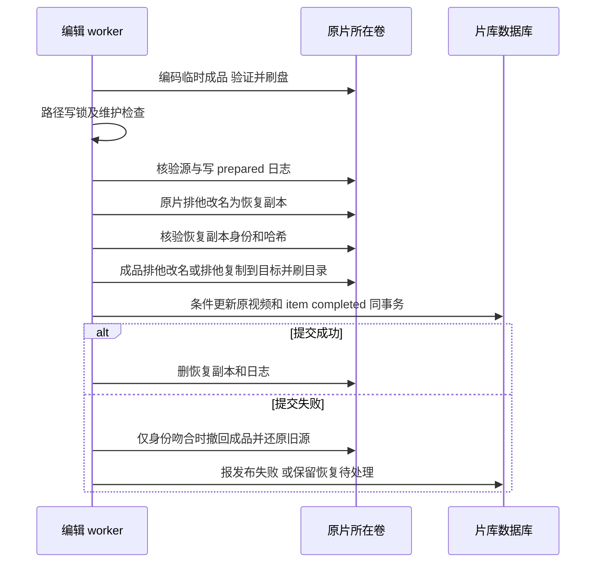

# 片库筛选、排序与自动黑边发现 · 需求设计文档

状态：v1 / 用户于设计交付后调用 `$exec` 授权实施；实际进度见[计划](../../plans/2026-11-11-library-crop-automation.md)。来源、整体职责与 D-LCA-01..03 见[概要设计](概要设计.md)；原始范围和用户裁定见[需求](../../../../.loopx/intake/2026-11-11-library-crop-automation/requirements.md)。
Support lenses：architecture-designer、sql-style；结论为扩展现有查询与编辑所有者，使用事务、唯一键和条件写入，不引入数据库行锁或独立调度系统。

## 架构依据与复用

| 当前证据 | 本次扩展与边界 |
|---|---|
| [library_service.go](../../../../services/library_service.go)：LibraryFilter、applyLibraryFilter、SearchLibraryVideoPage、CountLibraryVideos、保存视图 | 筛选唯一实现；分页、计数、随机、保存视图使用同一条件，不在前端过滤已取回数据 |
| [library_browse_sort.go](../../../../services/library_browse_sort.go)：键集分页与游标校验 | 增加文件名称与大小排序；不借用依赖 DisplayTitle 的 TitleSortKey |
| [LibraryToolbar.vue](../../../../frontend/src/components/video-list/LibraryToolbar.vue)、[libraryQuery.js](../../../../frontend/src/components/video-list/libraryQuery.js) | 扩展控件、查询键、重置与保存视图回填；当前管理页排序只有均衡和评分 |
| [video_edit_crop.go](../../../../services/video_edit_crop.go)：analyzeCrops、editCropUnion、buildCropPlans | 提取单视频纯检测入口，供手动分析及后台复用；不直接复用整项目分析的全批失败语义 |
| [frame_hash_service.go](../../../../services/frame_hash_service.go)、[background_task_registry.go](../../../../services/background_task_registry.go)、[idle_gate.go](../../../../services/idle_gate.go) | 仿照现有回填生命周期，逐项媒体槽；检测与导出分开登记 |
| [video_edit_exec.go](../../../../services/video_edit_exec.go)、[video_edit_service.go](../../../../services/video_edit_service.go)、[video_edit.go](../../../../models/video_edit.go) | 现有另存发布新建视频行、以大小恢复；替换需要独立分支，不能直接调用 ingestEditOutput |
| [工作台合同](../../../context/workbench.md)、[片库合同](../../../context/library.md)、[BTPathPolicy](../../../../services/bt_path.go) | 固定黑边、转正/SAR 画布、人工导出；BT 托管视频禁止改写，仍可检测和查看 |

## 组合筛选与排序

D-LCA-01 的字段级合同如下；所有新增字段均向后兼容，空值保持旧行为。

| 输入 | 规则 |
|---|---|
| `LibraryFilter.directory_keyword` | 空串不筛；去首尾空白，按 `LOWER(videos.directory)` 字面包含搜索，路径中的上级目录也可命中 |
| `LibraryFilter.filename_keyword` | 同上，仅匹配 `LOWER(videos.name)`，含扩展名，不匹配显示片名或目录 |
| 既有 `keyword` / `path_prefix` | 保留原语义，各条件 AND；`path_prefix` 继续表示精确路径范围，不替代模糊目录条件 |
| `sort_mode` | 新增 `filename_asc`、`filename_desc`、`size_asc`、`size_desc`；旧默认 balanced、旧枚举不变 |
| `LibraryVideoCursor.filename` | 仅 filename 排序使用；原始完整文件名（空文件名也合法），不执行 trim 或 lower |
| `LibraryVideoCursor.size` | size 排序使用实际字节数，0 合法；负数游标拒绝；保留 balanced 使用此字段的旧语义 |

SQL 使用绑定参数和既有 escapeSQLLike，`%`、`_`、反斜杠是字面字符。大小写沿用当前 LOWER 查询的数据库口径，不额外声称跨数据库 Unicode 折叠完全一致。目录和文件名同时为空时等同旧筛选。新增条件应用于所有接收 LibraryFilter 的查询，不改变字幕关键词或语义相关性排序；语义结果中仍先以结构化条件限定候选，排序控件不冒充相关性排序。

文件名按原始 UTF-8 二进制顺序，SQLite 使用 `COLLATE BINARY`，PostgreSQL 使用 `COLLATE "C"`；大小写有别，不做拼音或自然数字排序。比较、ORDER BY、游标相等判定须使用同一 collation。以 `filename_asc` 为例：`name > cursor.filename OR (name = cursor.filename AND id > cursor.id)`；降序同时反转比较符和 id 顺序。size 以 `(size,id)` 同方向排序。filename 模式其余游标字段必须为空，size 模式 filename 及其他专用字段为空；模式不符、缺 ID 或混用字段拒绝，不静默回第一页。返回仍为 `LibraryVideoPage`，取 limit+1 判断下一页。

版本聚合先按现有代表项规则选代表，再按代表文件的名称/大小排序；不按隐藏成员或作品标题排序。计数不受排序改变影响。分页只保证同一数据状态下无漏无重，不承诺跨页期间重命名或文件替换的快照一致性；变更通知触发现有原位刷新。

`SavedLibraryView` 新增两个 text 字段，由创建、更新、返回和视图回填完整携带；旧行迁移为空串。规范化与清空筛选、命令跳转、随机、组合搜索应用链路必须传递字段。列表不做全量前端排序。先不新增查询索引，不凭假设声称包含搜索加速；现有双库与游标测试扩充即可验证语义。

## 全库黑边发现

**D-LCA-04 · Data / Workflow Contract · Accepted for implementation**（来源 AC-03，细化 D-LCA-02）：检测状态归发现 worker 所有，项目归 VideoEditService；以下唯一键、事务和版本判定是重复调度及中断的约束。下游需验证同版本只创建一次和用户修改不被覆盖。

新增 `VideoCropDetectionState`：`video_id` 主键兼外键 CASCADE，`source_version`（size:mtime_ns）、`algorithm_version`、`revision` 单调递增、`status`、`result_json`（EditCropResult）、`project_id` 可空逻辑引用、`last_error`、`checked_at`。无 gorm default，服务显式初始化；AllModels 排在 Video 后，加入双库迁移/备份/模型快照。与视频一对一；项目删除不会删检测状态，其逻辑引用可空，避免同版本自动重建已删除草稿。

单 worker，逐项 Acquire MediaWorkSlot。候选范围沿用活跃片库扫描根、黑名单和可见性边界，排除软删、失效、不可访问项；包含 BT 视频但不能因此绕过替换保护。新增时、扫描/监听确认指纹变化时、启动时唤醒；开启期间每 10 分钟有界分页对账（按 ID，不把全库装内存），同版本成功、无结论或失败均不重复自动解码。来源版本或算法版本变化时重新检测。文件恢复但 size/mtime 恰好相同的外部 ABA 沿用现有指纹局限，不宣称识别任意外部改写。

保持当前算法：显示画布 7 个时间点，每点最多 8 帧/2 秒、单命令 30 秒；有效样本至少 3 个，合法框取并集。矩形小于全画布才算 detected；全画布为 no_borders，证据不足为 undetected。未识别不是无黑边。样本读取失败、超时为 failed，不写建议。检测前后校验源指纹；变化则丢弃结果，下一轮处理新版本。

| 原状态 / 事件 | 守卫、结果与副作用 |
|---|---|
| 无行、版本过期 → 待检测 | 查询派生，不需要批量创建 pending 行 |
| 待检测 → detected | 在同一事务条件写状态并通过编辑服务事务内入口创建单素材 crop 草稿，写入建议和来源版本；项目 draft，绝不 queued |
| 待检测 → no_borders / undetected | 只存结果，不建草稿；同版本完成 |
| 待检测 → failed | 记录脱敏错误；同版本不自动重试，用户手动 Start 可重做失败项，或等源版本改变 |
| 待检测 → 取消 | 不提交当前项；已完成项保留；下次开启继续 |
| 任意结果 → 版本变化 | 旧结果失效；已有项目保留历史，旧指纹导出按 source_changed 拒绝，不改用户配方 |
| 重复提交 / CAS 失败 | 事务回滚含项目创建，重新读取已存在行，本轮不重复创建 |
| 数据库错误 | 停止本轮，任务中心报失败；不把已检测但未提交结果视为成功 |

读出行 revision=N 后以 `video_id,revision=N` 条件更新并递增；首次插入靠主键唯一约束，冲突回滚项目。与项目创建和状态绑定一次事务；不先创建项目再独立写去重标记。项目已删除或被用户改动，不影响同版本“已投递”事实。新源版本可创建新草稿，老草稿不复用。检测时尚未产生中间持久 running 状态，异常退出只损失当前项，不阻塞后续恢复。

设置默认 false，关闭后取消当前检测、停止定时唤醒；项目仍可手工导出。任务 DTO 沿用回填形状（running、progress、processed、total、failed、等待原因），计数按本轮，错误脱敏。新增 App `StartCropDetection()`、`GetCropDetectionStatus()`、`CancelCropDetection()`；Start 单次启动不隐式修改自动开关，运行中幂等返回当前状态，手动 Start 除正常待检测项外也纳入同版本失败项；取消本轮不关闭自动开关，下轮可再调度。Wails 错误经 WithoutAbsolutePaths 返回；设置和任务中心调用全部新绑定，生成方式遵循 AI-CONTEXT。状态事件 `crop-detection-state`；诊断带 video ID 和原因，不记录完整路径。

## 整片裁剪替换

**D-LCA-05 · Data / Operational Contract · Accepted for implementation**（来源 AC-04，细化 D-LCA-03）：文件替换由 VideoEditService 承担；数据库与文件不具备共同事务，必须记录恢复证据并逐项提交。禁止以旧发布的“文件大小相同”推断替换已完成。下游实现及独立审查必须覆盖每个崩溃窗口。

配方新增 `crop.publish_policy`：`replace_full` / `save_copy`。新 crop 草稿（含自动发现）默认 replace_full；项目中整片项执行替换，range 非空项仍另存，界面逐项显示结果类型。历史无此字段配方按 save_copy 解释，历史 queued/running 冻结计划不改；新复制草稿按新默认并明确显示。冻计划携带 `publish_mode`、源视频 ID、源路径、源版本和实际目标容器。预检和执行均重新推导整片/片段约束，不信任客户端传来的替换路径。

目标扩展名和原完整路径保持，实际容器沿用来源；具体 profile 由下表定义，不暗中转另存。替换模式隐藏输出目录与改名设置；不能把用户输出路径覆盖成另一个文件。

沿用字幕风险与丢流警告，不自动确认。整片替换保持旁挂字幕原样和路径，视频内轨道按既有可支持映射处理；片段另存沿旧时间线重写字幕。BT 托管 namespace 禁止替换并显示 `replace_managed_source`，不能用客户端已离线推断解除托管。符号链接来源/链接父目录在替换模式返回 `replace_path_unsafe`，不悄悄替换链接或链接目标；仍可用现有片段另存。替换前原路径须是可写普通文件，权限不足或基础同卷改名、排他创建、刷盘操作不可用时明确失败；不因缺特殊排他改名拒绝普通可写外接盘，采用下节复制分支。

### 原容器编码（用户已确认保留完整文件名和扩展名）

来源：用户补充“必须保持原完整文件名及扩展名，按原容器编码”。整片替换 S=T，大小写、基本名、扩展名与父目录全部保持。移除转 MKV 政策，不在错误时切换容器或另存。以 ffprobe 实际容器和扩展名映射共同核实；伪扩展名/不一致报 `source_container_mismatch`，不能把 MKV 数据写入 AVI 文件名。

新增 `editContainerProfile` 为编辑服务内部编码配置，不是新服务。显式固定 muxer、视频/音频编码器、允许的字幕/附件和像素格式；freeze plan 记录解析后的配置和原容器，执行不再依据后缀临时猜测。现有 completeEditPlan 的“复杂轨道改用 MKV”仅保留在旧另存路径；整片替换必须走本表。

| 来源扩展名/实际容器 | 显式 muxer | 视频 / 音频编码方案 |
|---|---|---|
| `.mp4`、`.m4v` / MP4 | mp4 | 沿现有 H.264/HEVC 选择和对应编码器；AAC |
| `.mkv` / Matroska | matroska | 沿现有 H.264/HEVC；AAC |
| `.mov`、`.qt` / QuickTime | mov | H.264/HEVC；AAC，保留 MOV 容器标识 |
| `.avi`、`.divx` / AVI | avi | mpeg4；libmp3lame |
| `.wmv`、`.asf` / ASF | asf | msmpeg4（codec=msmpeg4v3）；wmav2 |
| `.flv` / FLV | flv | flv（codec=flv1）；libmp3lame |
| `.f4v` / F4V | f4v | H.264；AAC |
| `.webm` / WebM | webm | libvpx-vp9；libopus |
| `.ts` / MPEG-TS | mpegts | H.264；AAC |
| `.3gp` / 3GPP | 3gp | H.264；AAC |
| `.mpg`、`.mpeg` / MPEG-PS | mpeg | mpeg1video；mp2 |
| `.vob` / MPEG-PS VOB | vob | mpeg2video；mp2（文件级输出，不重建 DVD 目录结构） |
| `.rm`、`.rmvb` / RealMedia | rm | rv10；AC3；容器仍为 RealMedia，不宣称保持 RV40 编码 |

执行适配：当前 encodeEditSegments 统一先写 MKV/PCM 段，再 editConcatArgs 固定 AAC 且最终只选 MP4/MKV，不能只改后缀或 muxer。整片 crop 恰好一个来源/区间，新增服务内部 encodeFullCrop 路径，复用现有转正/SAR、固定框、轨道映射、进度/取消、验证及发布，按冻结 profile 一次编码到 final.part（显式 -f），不经过仅适合旧计划的 MKV/PCM+concat。音频编码器、采样率/声道和视频选项都由 profile 生成，不给 mpeg4/rv10 等套用 libx264 的 preset/profile 参数。片段另存及其他三类任务继续现有执行路径，不将本次容器扩展改成全编辑引擎重写。checkEditEncoders、finishEditOutputs 的 AAC 假设在整片替换分支改为读取冻结 profile；预检能力检查及 UI 轨道/编码摘要都必须显示实际 profile，旧另存仍沿原逻辑。预检短样本必须使用同一个 encodeFullCrop 参数生成器，覆盖音频、字幕与附件约束；最终验证同时核对 codec/muxer/裁剪尺寸，不只核对流数量。

保留原容器不等于保留原视频编码：裁剪必然重编码，以上具体编码选择为技术方案，导出设置显示来源/输出编码、预计体积及质量风险。默认质量参数在各 profile 明确配置，不让 ffmpeg 自选默认编码；旧 H.264/HEVC 的码率估算继续使用，其他编码按原视频码率和编码器允许范围设定，不承诺同码率同质量。HDR/位深无法在目标 profile 保留时沿用既有损失警告与阻断规则，绝不默默降为 SDR。

预检除检查 muxer/encoder 存在外，用实际 crop 尺寸、帧率、像素格式和轨道映射生成短临时样本并 ffprobe 核验容器/轨道。旧格式尺寸或帧率限制、字幕/附件不兼容、声道数不支持须在完整编码前返回 `container_profile_incompatible`，列出具体冲突；缺组件报 encoder_unavailable。不得为兼容偷偷补黑边、缩放到另一尺寸或丢轨。裁剪批次的轨道选择以可选 scope_video_id 明确限定当前素材，冲突DTO携带同一作用域，前端保存/移除选择也须包含作用域；未限定作用域的旧crop选择保持原来的不生效语义，不将一个素材的drop应用到其他素材；merge/trim原全局轨道合同保持。音轨按本表编码，各 track 保留语言/标题与选择语义；字幕/字体能够原容器承载时保留，不支持时要求用户在现有轨道冲突 UI 明确 drop 后再预检，不能自动放弃。

表覆盖当前 defaultVideoExtensions 所有默认扩展名。用户自定义扩展名只在可映射实际容器到上述 profile 且对应后缀确实表示该容器时允许；否则 `container_profile_unsupported` 明确拒绝且保留原片。RealMedia 等老编码在某些裁剪尺寸下不能编码是具体输入失败，不再笼统以“只支持MP4/MKV”拒绝整个格式。将来新增 profile 仍归编辑服务及其合同所有。

证据：[FFmpeg 格式文档](https://ffmpeg.org/ffmpeg-formats.html)、本机 `/opt/homebrew/bin/ffmpeg -h muxer=rm|asf|avi|flv|webm|mpeg|3gp|mpegts|mov|f4v|vob` 的查询输出；已确认这些 muxer 在本机可见及所报默认 codec，并未执行编码。实际 App sidecar 的能力以运行时预检为准；编码配置与原容器端到端尚待实现验证。

### 外接盘发布合同

本节明确覆盖“不支持排他改名”的卷，不把特殊 syscall 不可用当作磁盘不可用。当前另存 helper 已在 ENOTSUP/EOPNOTSUPP/ENOSYS 时排他复制；替换不能直接复用其中删除源文件的收尾。

- 原片进入本项私有工作目录的旧副本位置：该目录由应用独占创建、核验身份，无外部输入路径；位置必须不存在。优先排他改名；卷不支持时使用同卷普通改名到私有位置。禁止用普通改名覆盖用户可访问的最终目标。此处信任边界为本项私有目录没有第三方写入者；不能将它扩展到公共输出目录。
- 成品落位：支持排他改名用排他改名；不支持时以 O_CREATE|O_EXCL 新建最终目标，先持久化 copying 意图；创建后在写任何内容前记录打开句柄的文件身份并刷盘日志，再复制、Sync、关闭并核对 SHA-256。创建成功但身份日志尚未持久化即崩溃时，保留文件与旧副本报恢复待处理，不猜测归属。完整暂存成品和旧副本保留到数据库提交成功。不得截断现有目标，复制失败不得删除原片旧副本。
- 复制前预算除当前工作文件外，还要额外容纳一份完整成品；不足就在移动原片之前报 disk_full。FAT32 等单文件上限由卷能力预检及实际创建/写入共同约束；无法完整写入、只读、文件/目录 Sync 真正失败均终止，不回退成“成功但未同步”。
- 发布全程持应用路径写锁；扫描、监听、预览和本应用新播放请求必须识别本项发布保护，避免把正在复制的目标当成品。已经打开的播放器继续使用旧句柄；外部程序仍可能看到缺失或部分文件，导出状态显示“正在替换，请勿打开或修改此文件”。不承诺第三方播放无缝切换。
- 普通复制失败：只有仍是本次创建句柄对应的文件才能移回工作目录隔离；记录其身份，不凭路径删除。然后排他还原旧源；如果盘离线或发现外部冲突，保留所有可定位副本，进入 replace_recovery_pending。旧源已移到私有位置但新目标只复制一部分的崩溃窗口必须进入下表的专用分支。
- 还原也走同一能力分支：支持时排他改名；不支持时日志写 restoring，O_EXCL 创建原路径，先持久化还原目标身份，再从完整旧副本复制、Sync、校验旧源 SHA-256，成功后才清理旧副本和还原日志。还原不删除唯一旧副本。还原中再次中断，能核实为本项部分还原文件时先隔离该文件，再重做还原；身份缺失或改变则保留现场，不循环覆盖。
- 不支持特殊排他改名应在同卷小型探测文件上判定；只识别预期不支持错误，EINVAL 需确认调用参数正确且同卷探测证实，不能吞掉权限、I/O 或来源缺失错误。探测失败终止本项。

依据：[Apple rename 文档](https://developer.apple.com/library/archive/documentation/System/Conceptual/ManPages_iPhoneOS/man2/rename.2.html)说明普通改名会覆盖现有目标，所以只允许用于本项私有空位置；[Linux open 文档](https://man7.org/linux/man-pages/man2/open.2.html)定义 O_EXCL 创建语义。它们支持 API 选择，不代表目标外接盘已经实测。SMB/NFS 等远程卷若不能兑现排他创建/持久化要求则明确拒绝，不能仅凭文件系统名称判定支持。

### 结果页与清理调用方

导出项返回 DTO 新增 `publish_mode: replace_source|save_copy`，来自冻结计划；历史缺值规范化为 save_copy。替换项结果页显示“原文件已替换”，隐藏“确认成品后清理原片”及“与原片建立版本组”。[EditResults.vue](../../../../frontend/src/components/video-workbench/EditResults.vue) 目前会对完成项暴露清理入口，不能直接沿用；宿主 cleanup-sources 入口还须排除 output_video_id 等于来源 ID 的项，并拒绝自 ID 版本分组。片段另存继续原有确认/清理语义。必须新增消费者回归，避免同 ID 输出把唯一成品误当原片删除。

### 文件与数据库提交顺序

沿用 item work_dir（原视频同目录、同卷隐藏目录）。准备完整编码、现有 ffprobe 验证并增加裁剪尺寸校验，刷盘后才进入发布。日志 `replace-manifest.json` 记录 item/source ID、固定目标/暂存/旧副本名字、旧新 SHA-256、源身份、状态；日志临时写、Sync、改名、Sync 目录。旧源哈希在编码前后及移到旧副本后核验，排除大小/mtime 未变但内容变化；新哈希在验证后计算。路径不能由外部日志任意指定，恢复严格验证 work_dir、item 与同目录固定名字。

原片→旧副本与成品→目标之间存在无文件窗口，复制路径还存在部分成品窗口，不宣称原子交换。路径锁保护本应用扫描/移动/删除，不能阻止外部进程；发布阶段发现原路径被他人占用即冲突，绝不覆盖新到的外部文件。两个整片项目对同源文件顺序发布，后一个必须按旧源指纹/哈希失败；不重复覆盖前一成品。维护等待该短发布区间，取消只在发布前生效。

事务条件要求源仍活跃、path/size/updated_at 与冻结快照相同；更新媒体技术字段与 UpdatedAt；Name/Path/Directory 保持原值，不覆盖观看、评分、标签、人物、片单、标题和版本组关系。`output_video_id=source_video_id`，无新视频行。item 以 running/phase=publish 条件更新 completed，事务任何条件 0 行均回滚；丢失事务响应先查 item 是否已 completed，不在结果未知时盲目还原文件。用户资料变化可导致冲突，允许用户重试，不加自动重试。

替换提交时使旧派生缓存立即不可用：缩略图、预览帧、媒体探测、播放代理、pHash/帧序列、人脸观察、场景/语义及章节索引按现有源版本失效方式处理；检查没有源版本保护的消费者，必须在同事务删除/标旧，不能仅靠 UpdatedAt 自行失效。字幕索引整片时间线不变但嵌入流须重新探测。用户手工资料不删除；通知刷新列表和播放源。不得用当前 RefreshVideoMetadata 的一次独立事务替代整个原记录+item 原子提交。

### 恢复判定

恢复入口增加 `RetryEditReplacementRecovery(itemID)`：工作台只对 replace_recovery_pending 项显示“磁盘恢复后重试恢复”，请求只有 item ID，由服务加载冻结计划和日志，不接受客户端路径；成功返回最新 EditProjectView，仍有冲突以脱敏错误 replace_recovery_pending 返回并保留现场。入口使用既有 App 服务可用性检查、维护围栏、路径写锁；与启动恢复共用同一恢复函数。RequeueEditProject 遇未决替换日志必须拒绝，不能重建工作目录。

恢复在启动扫描/监听/自动发现之前，先处理替换 item；未决 item 的源路径受保护，扫描不得误删原视频，重新导出不得覆盖现场。继续复用现有工作目录，不引入另一个恢复守护进程。

恢复统一以 S=旧源路径、T=输出目标、B=恢复副本、C=item 已 completed 判断，S=T 时合并同一路径。先查数据库提交事实，再按下表从上到下匹配；数据库不可读时不做破坏性恢复。

| 现场（须验证身份和 SHA-256） | 恢复行为 |
|---|---|
| C 且 T 是成品；S=T 或 S 不存在 | 仅清理已证明属于本项的 B/日志；清理失败以完成伴提示保留，绝不复活旧扩展名文件 |
| 非 C，T 是完整成品，B 完整；S=T 或 S 不存在 | 核实冻结计划后补做同一提交事务；失败按身份安全隔离 T 并还原到 S；不重编码 |
| 非 C，T 是本项 copying 部分文件，B 完整；S=T 或 S 不存在 | 按持久化创建身份核实归属，隔离部分 T，按能力分支还原到 S，标 interrupted；身份缺失/改变则不碰 T |
| 非 C，S 为本项 restoring 部分文件，B 完整；T=S 或 T 已被隔离 | 核实还原目标身份后隔离部分 S，按还原分支重做；B 保留到成功 |
| 非 C，S 与 T 均不存在，B 完整 | 按还原能力分支还原到 S；失败保留现场并报 replace_recovery_pending |
| 非 C，S 为完整旧源，T=S 或 T 不存在，成品仅在暂存位置 | 尚未替换或还原已完成，保持 S，标 interrupted，可重新预检 |
| 其他，包括 C 但 T 不符、S/T 被外部文件占用、日志不完整、B 不符或卷离线 | 不覆盖、不删除现场，保留原提交事实，展示 replace_recovery_pending 和副本位置；不能把 completed 降级为重新编码 |

prepared 之后任何一步强杀都按实际文件和 item 提交事实判断，不仅按最后写下的 phase。全流程不先删原片；失败补偿只针对身份吻合的本项文件，不移走外部新文件。现有 finishItem、processItem 开头 RemoveAll、RecoverOnStartup、删除项目和退出清理必须统一识别替换日志：工作目录清理/删除项目必须拒绝尚未恢复的替换项，防止把唯一旧副本当普通缓存清掉。批次仍逐项提交，部分完成沿用 partial 和“继续未完成项”；已成功替换项不再执行。

## 迁移与兼容

新增自动开关、保存视图两字段和检测状态表；无字段默认装饰器，服务显式写入。迁移旧视图为空、旧设置 false；SQLite/PostgreSQL 均需迁移往返 fixture 与 schema golden。旧配方无策略按另存，确保升级不把已排队任务变为破坏性任务。

新发布日志存在时不支持直接降级旧程序（旧程序可能清理工作目录）；降级前须在新版本完成恢复且没有未决替换项，再关闭自动开关。新增表/列不破坏旧另存数据，但不能据此承诺带未决文件事务的安全降级。设置开关关闭仅停发现，不撤销已完成替换。

## 验证与交接

### Verification Strategy

| 来源场景 | 设计走查结果 | 验证范围（结果见下方最终QA及执行记录） |
|---|---|---|
| TC-01 → D-LCA-01 | `/电影/甲/预告.mp4` 同时命中；目录甲但文件不含预告、其他目录同名分别被排除；空值保持旧语义 | 双库分页/计数/保存视图/随机交集，字面转义；工具栏与清空回填测试 |
| TC-02 → D-LCA-01 | 同名同大小由 ID 决定；模式切换清游标；显示标题不参与文件名排序 | 双库多页遍历含零值、同值、中文/ASCII；版本聚合与旧排序回归 |
| TC-03/04 → D-LCA-02/04 | 检出→事务建 draft；重复唤醒复用投递事实；无黑边不建项目，失败项继续；用户调框不被后台覆盖 | 合成黑边/全黑/无边/不足样本素材；关闭/取消/超时/重启/数据库失败；唯一冲突及 CAS 失败注入 |
| TC-05 → D-LCA-03/05 | 新整片草稿替换原路径及同 ID；range 非空仍另存；旧无策略项目另存 | 真实 FFmpeg 合成每一容器 profile（至少各一成功及相关尺寸/轨道失败样本），画面/尺寸/时长/轨道、用户关系、旁挂字幕、无额外行；历史计划兼容；替换结果无清理/自版本分组入口且宿主防御生效 |
| TC-06 → D-LCA-05 | 编码失败不动源；源冲突不发布；落位后事务失败仅安全还原；未知现场保护不清理 | 每次日志/改名/提交/清理前后注入失败和强杀，重启恢复；并发外部写入/同源项目/空间不足/只读/离线磁盘/维护、排他改名不支持→完整复制、复制及还原中强杀、部分目标归属缺失；缓存不可复用 |

独立设计审查：只读审查指出替换结果页可能清理唯一成品、无排他改名卷缺少复制还原，以及恢复入口缺口；已修改对应合同，审查者复核这些增量后确认在设计层关闭。随后用户要求原完整文件名/扩展名/容器不变，已移除跨扩展名提案，独立审查另指出原容器 profile 必须贯穿实际编码、能力检查和界面摘要；已明确 encodeFullCrop 分支与共用预检参数生成器，审查者复核该增量后确认 finding 在设计层关闭。不把文档审查当实现验收。

实际 QA：已阅读当前来源与实现并完成上述正常/异常文档推演；这不是功能测试。本轮 Python 检查三个文档的本地链接、显式锚点与围栏通过；git diff --check 无报错（新增文档另由上述脚本读取检查）。本机未发现 mmdc，未渲染图示，不声明视觉验证通过。运行测试和源码修改本轮未执行。

### Design Contract Index

| 合同 | 来源 | 所属权威位置 |
|---|---|---|
| D-LCA-01 Behavior | AC-01/02 | [概要查询决策](概要设计.md#D-LCA-01) |
| D-LCA-02 Operational/Workflow | AC-03 | [概要任务决策](概要设计.md#D-LCA-02) |
| D-LCA-03 Behavior | AC-04 | [概要替换范围](概要设计.md#D-LCA-03) |
| D-LCA-04 Data/Workflow | AC-03 | [发现状态合同](#D-LCA-04) |
| D-LCA-05 Data/Operational | AC-04 | [替换与恢复合同](#D-LCA-05) |

### Planning Handoff

用户已固定：全库持续后台发现、仅入工作台不自动裁剪、整片替换/片段另存。设计交付不等于用户接受其余技术选择，也不构成实施授权；设计阶段未建实施计划；用户随后调用$exec，现按已链接计划执行。

产品裁定已齐：保留原完整文件名、扩展名与容器，已替换 MKV 改名提案；原容器编码表明确覆盖当前默认扩展名。外接盘不支持特殊排他改名已由上述排他复制分支明确处理，不再列为待决；基础写入/改名/刷盘不可用仍是操作失败，保留旧副本。符号链接替换按明确拒绝处理。路径空窗与复制期间第三方可见的部分文件是本方案公开代价，不承诺无缝替换。没有待用户选择的容器范围；具体 profile 需实现时按样本预检验证，不能把查到 muxer 当作编码成功。

破坏性发布实现前需独立检查准确 diff、恢复身份校验和旧副本清理；用户已授权按本方案实施；实际进度和证据以执行计划为准。未验证范围不得声称性能或外接盘实测通过。

### 最终实现验证补充（2026-11-11）

用户后续$exec后已实现本设计。SQLite全量Go、相关PostgreSQL18.1/pgvector0.8.5与迁移往返、检测/替换race、vet、真实FFmpeg各容器、前端构建与16静态守卫、裁剪WKWebView合成素材检查通过。6项高风险承重变异均被捕获并还原。全部相关Important已按精确增量独立复核关闭。

前端全组件运行中有一项原有Recap月份断言在未改baseline同样失败，未扩范围修复；本次任务数断言已修并复验。历史“未运行”的QA是设计阶段记录，当前命令、范围、退出状态及环境失败均以[最终执行记录](../../plans/2026-11-11-library-crop-automation.md)为准。未使用用户真实片库，未进行实际外接盘断电、安装或部署验收。
